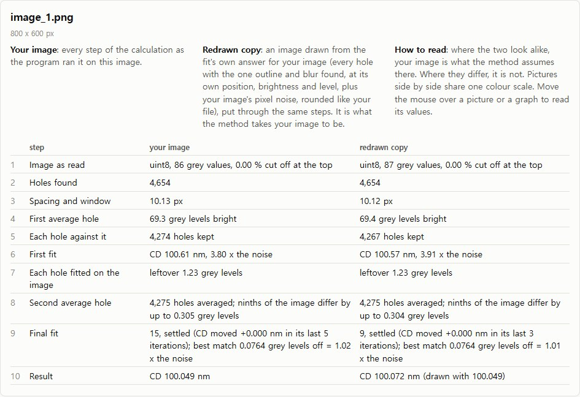
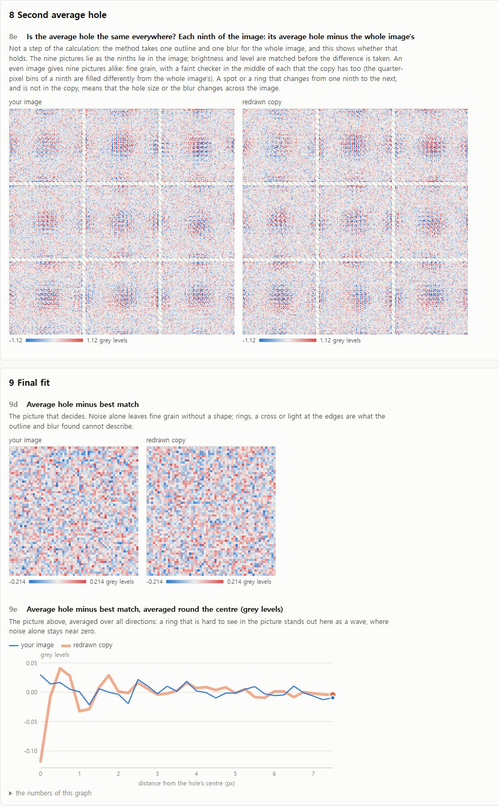
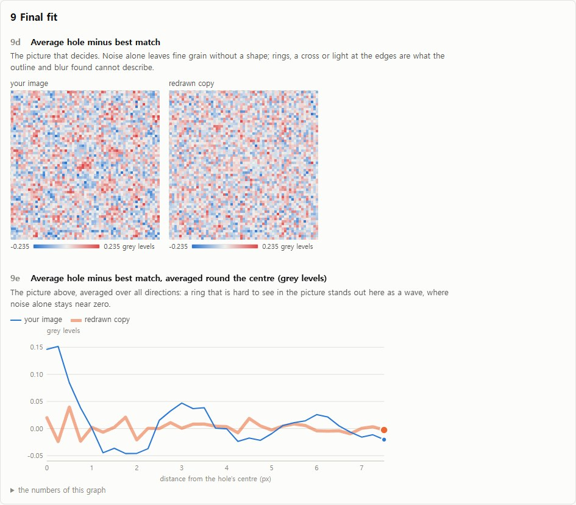
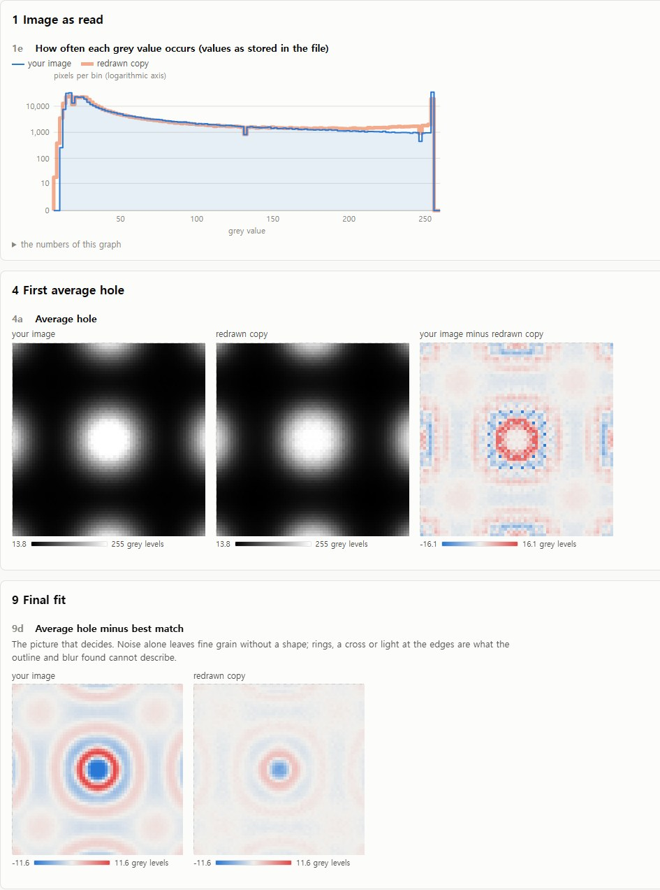
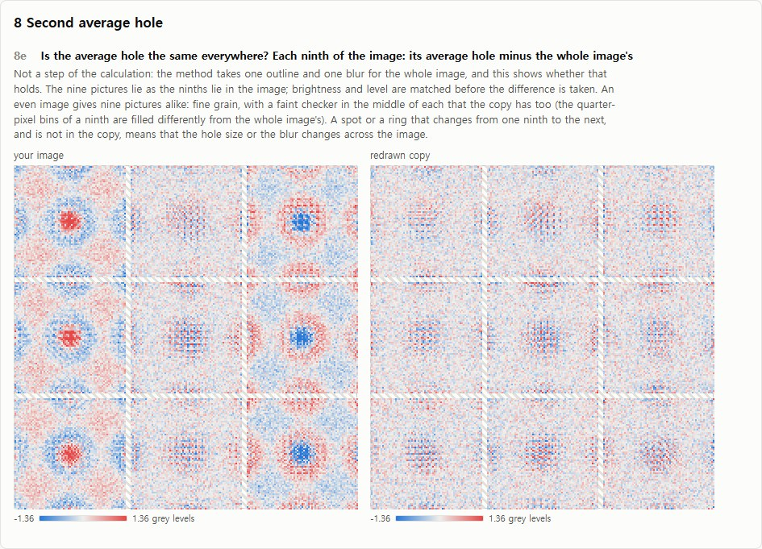
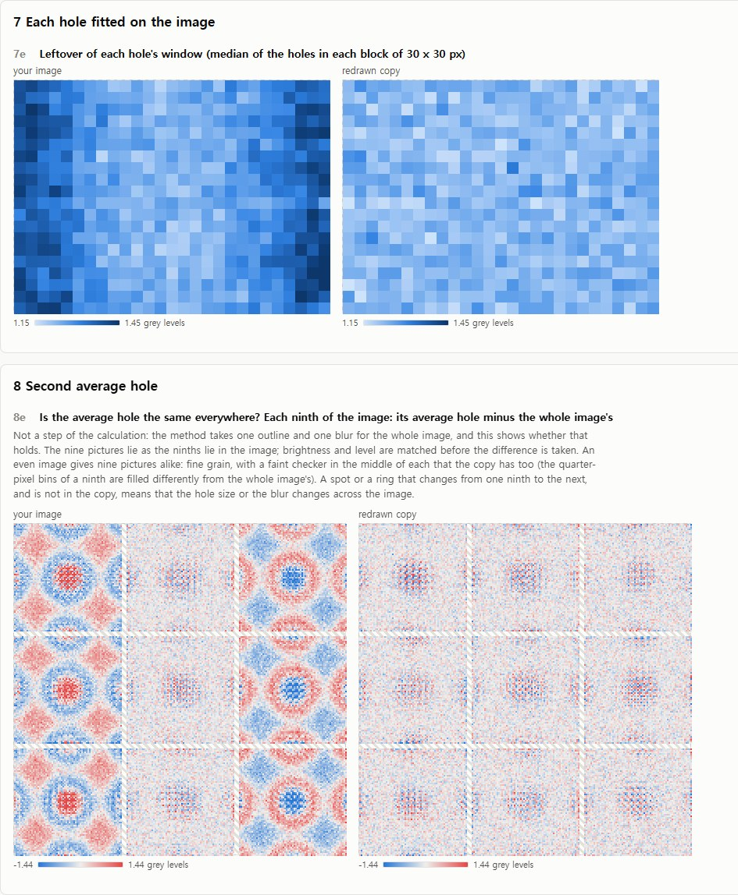
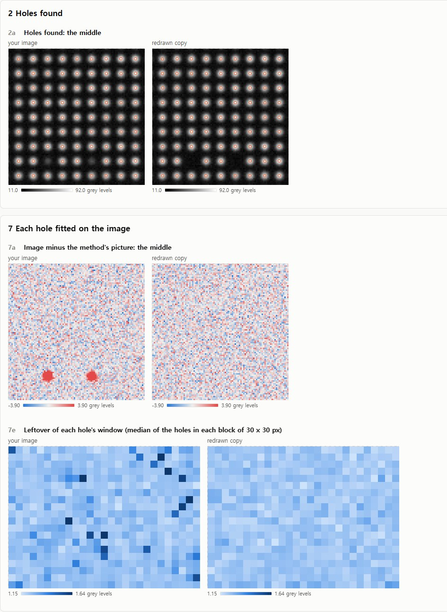
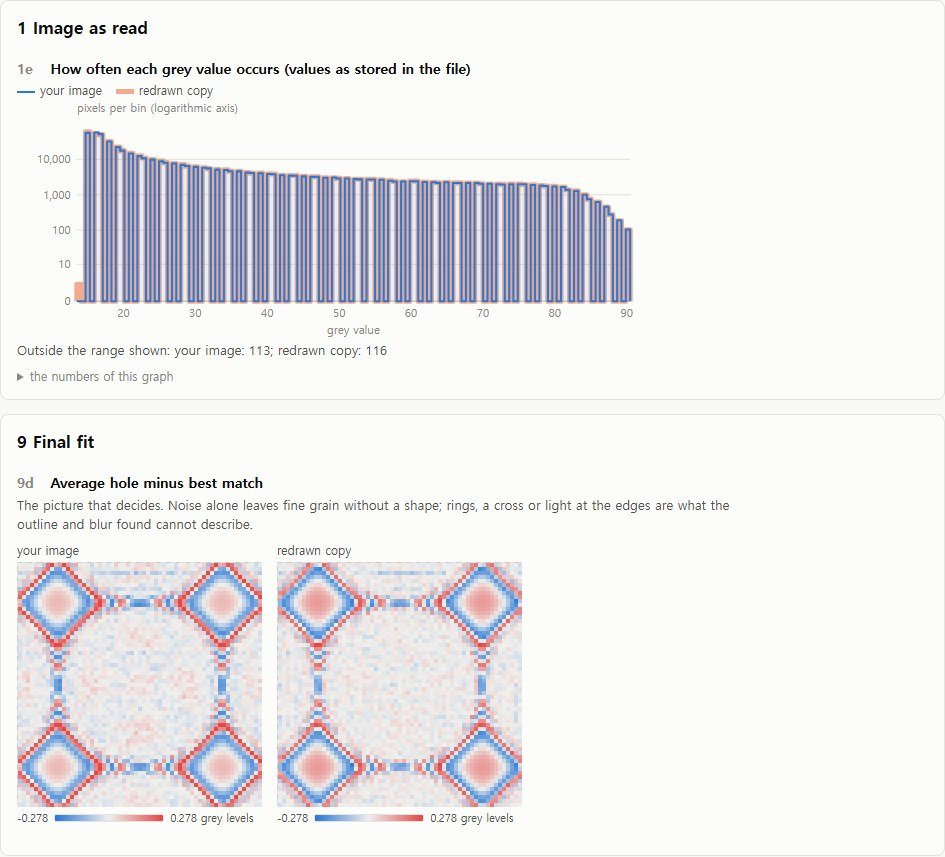
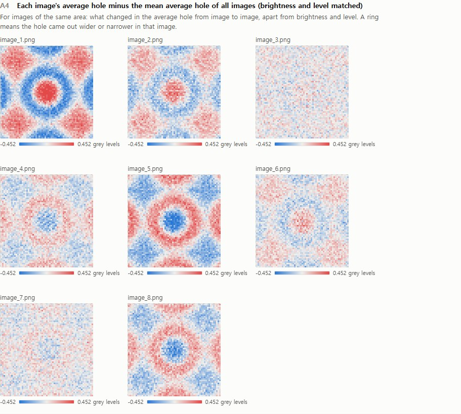

# Outline fit, step by step (`scripts/outline_fit_steps.py`)

A page in the browser that shows **every step of `outline_fit_fast` as pictures**, for every image of a folder, so
that a step that goes wrong on an image can be seen instead of guessed. It shows the library's own calculation (the
fit is run unchanged, with a record of what each step produced); it measures and fixes nothing.

```bat
python scripts\outline_fit_steps.py D:\data\png_images --output D:\data\steps --pixel-size 21 --unit nm
```

- Use the options the folder report was run with: `--outline-blur gauss2|lens`, `--invert`, `--seeds`,
  `--threshold`, `--area-min`, `--area-max`, `--pad`, `--device`. They decide which holes are found and what is
  fitted, exactly as in `cd_report.py` / `cd_fast_report.py`.
- Reads every `.png` of the folder (and one page of every `.tif` / `.tiff`: `--page N`, from 0), or one image file.
- Writes `OUT\index.html` with `OUT\data\*.js` and opens it in the browser (`--no-open`: only writes it). The page
  works offline; move the whole `OUT` folder if you move it.
- Needs the GPU, as the method does. Measured on an RTX 4060 Ti, with the copy (see below): 3.3 s per
  1378 x 2048 image (26,000 holes), 7 to 8 s per 2048 x 5408 image (104,000 holes); 4 to 5 MB of page data per
  image. The first call on a machine compiles the GPU routines (about half a minute, once).
- The console prints one line per image and, last, the page's path.

## The page



*Fig. 1. The top of an image's page: one line per step, your image beside its redrawn copy. Click a line (or the
numbers 1 to 10 in the bar above) to go to the step. The image shown is a generated one.*

**Your image** is the calculation as the report runs it on that image.

**Redrawn copy** is the reference for what "normal" looks like on this very image. After the fit, an image is drawn
from its answer: every hole with the image's one outline and one blur, at its own position, brightness and level
(fitted to your image under that outline and blur), plus noise as your image has from pixel to pixel, rounded and cut
like your file. That copy goes through the same steps. It is what the method takes your image to be.

- Where the two look alike, your image is what the method assumes at that step.
- Where they differ, it is not, and the picture shows how.
- Where **both** look odd in the same way, it is the method on this kind of image (for example grey steps too
  coarse for the noise), not something only your image has.

Pictures side by side share one colour scale; grey pictures are light, blue-white-red ones are differences (white =
none). Under the mouse a picture or graph gives its values in grey levels, pixels or nm. Every picture has a number
(9d), so what looks odd can be named in a few words. "Show the redrawn copy" hides or shows the copy.

**All images** (button at the top) puts the folder's images side by side: the steps' numbers in one table, the CD
after each iteration of every image's final fit in one graph, and rows of small pictures. For images of the same
area, picture A4 shows what changed in the average hole from image to image.

## The steps

| # | What the code does | Look first at | Odd if |
|---|---|---|---|
| 1 | Reads the image (dark holes: turns it over) | 1a whole image, 1e grey values | tops cut off at the file's highest value, few grey values, areas without holes |
| 2 | Finds the holes (the report's search) | 2a-2c dots on the holes, 2d how densely they lie | holes without a dot, dots without a hole, areas with fewer holes |
| 3 | Spacing = usual distance to the nearest neighbour; window = 0.75 spacings to each side | 3a distances, 3b the window | two peaks in the distances (two patterns) |
| 4 | Lays all windows on top of each other in quarter-pixel steps: the average hole | 4a | not round, not centred, a flat top |
| 5 | Compares each hole with the average hole; drops holes of unusual brightness or leftover; averages again | 5a leftover map, 5d dropped holes | an uneven leftover map, dropped holes in one place |
| 6 | First fit: one sharp outline + one blur (+ neighbours' light + a level) to match the average hole | 6d difference | nothing by itself: a pattern here is usual, in the copy too (the holes are not centred yet) |
| 7 | Fits every hole's position, brightness and level on the image, the size held | 7a-7c image minus the method's picture, 7e leftover map | rings round holes, whole holes left over, a pattern across the image |
| 8 | Averages again at the fitted positions | 8e each ninth of the image against the whole | spots or rings that change from ninth to ninth and are not in the copy |
| 9 | Final fit, every number free, at most 30 iterations | 9d difference, 9e the same averaged round the centre, 9a-9c per iteration | a shape in 9d, a wave in 9e, curves still moving at the end, numbers on a limit (9z) |
| 10 | CD = diameter of the circle with the outline's area; every hole of the image gets it | the numbers | the copy does not give back the CD it was drawn with |

Picture 8e is not a step of the calculation. The method takes one outline and one blur for the whole image; 8e
shows whether the average hole is in fact the same in every part of the image.

## What a fault looks like

Generated images of 800 x 600 px with about 4,300 averaged holes of 100 nm (pitch 10.3 px, noise 1.2 grey levels, 8
bit), each with one fault planted. Your images have 7 to 25 times as many holes, so the average hole's noise is 2.5
to 5 times lower and the same faults stand out more. All numbers below are from these generated images.

### Nothing planted



*Fig. 2. An image that is what the method assumes (one hole size, a Gaussian blur, even noise). Image and copy are
alike in every picture: 8e nine pictures of grain with a faint checker in each (the copy has it too), 9d grain, 9e
both lines near zero.* Final fit 1.02 and 1.01 times the noise; the copy reads back the CD it was drawn with to
0.02 nm.

### A blur the model cannot describe



*Fig. 3. A lens of 60 nm inside a blur of 70 nm.* The CD is 1.5 nm low (98.47 for 100) while the final fit is only
1.13 times the noise (copy 1.02): in the picture 9d the rings can hardly be seen at this number of holes. Averaged
round the centre (9e) they are plain: +0.15 grey levels in the middle, -0.05 at 1.5 px, against a copy that stays
within 0.04.

### Bright tops cut off



*Fig. 4. Holes brighter than the file can hold.* Step 1: 7.1 % of the pixels at the highest value, a spike at the
right end of 1e. 4a: a flat-topped average hole. 9d: strong rings (12.9 times the noise). The copy is cut off like
the file, so it shows the fault too (6.0 times); the CD is wrong by 17 nm.

### Two hole sizes in one image



*Fig. 5. Left half 100 nm holes, right half 106 nm.* The final fit does not notice (1.03 times the noise, as the
copy: the average of two sizes fits like one size of 103.1 nm). Picture 8e does: the left ninths are sharper than
the whole image's average hole, the right ninths wider; the copy has nothing. In numbers: ninths differ by up to
0.43 grey levels against 0.32 in the copy; leftover of a hole 1.27 against 1.23.

### A blur that changes across the image



*Fig. 6. Blur 58 nm at the left edge, 72 nm at the right.* 7e: the leftover is higher at both edges than in the
middle, where the image's one blur fits. 8e: left ninths sharper, right ninths wider (0.56 grey levels against 0.32).
The CD is right (99.94) and the final fit sees nothing (1.06).

### Holes that were not found



*Fig. 7. 3 % of the holes much fainter than the rest.* 2a: holes without a dot in your image; the copy has gaps
there. 7a: whole holes left over. 7e: dark blocks. Image minus the method's picture, away from the frame: 1.70
grey levels against 1.22.

### Grey steps too coarse for a quiet image



*Fig. 8. Noise of 0.1 grey level in an 8 bit file.* Image and copy are alike and **both** far from their best
match (4.9 and 4.6 times the noise; CD 0.25 nm low, and the copy does not read back its own CD: 99.61 for 99.75).
That is the method on this kind of image, not a property of the image alone.

### Eight images of the same holes



*Fig. 9. All-images view, picture A4: 8 images of the same holes with new noise and the blur moved between 63 and
67 nm.* A red middle in a blue ring: the holes came out sharper in that image than on average; the reverse: wider.
The table A1 beside it shows where the fit put the change: here into the blur width (62.8 to 67.1 nm), with the CD
at 100.01 to 100.09 nm.

## What image and copy share, and what the copy lacks

- The copy is drawn with every hole's own position, brightness and level. Maps of those look alike on both sides
  whatever the image holds; the leftover, the dropped holes and the average holes are what can differ.
- The copy has one hole size, one blur, and the same noise at every pixel. An image whose holes differ in size, or
  whose noise grows with the light, has a higher leftover per hole than its copy. Step 10 gives both numbers: the
  noise from pixel to pixel and the leftover of a hole's window.
- At the frame both are poor: a hole cut by the frame is placed by the part of it that is visible (it may move
  0.5 px at most), and holes beyond the frame, whose light reaches into the image, are in your image and not in the
  method's picture. The corner piece (1c, 7b) shows blobs along the frame. Holes nearer to the frame than one
  window are not averaged and are left out of the maps.
- The pixel noise is read from image minus picture through a filter that keeps only what changes from one pixel
  to the next. Noise that neighbouring pixels share is not seen by it; the copy is then quieter than the image.

## Seen on generated images: the method's own behaviour

These show on images where nothing is wrong, in the copy as in the image. They are not faults of an image.

- **Step 6 has a pattern in 6d** (3.2 to 4.8 times the noise at 4,300 holes, 17 to 18 times at 104,000): the
  holes are averaged where they were found, a fraction of a pixel off. Step 9, after centring, is what counts.
- **Step 5's leftover map has a regular texture** at full size: the leftover against the first average hole
  depends on where a hole sits inside its pixel.
- **"Cut off at its limit" is not always "still moving".** A fault-free 1378 x 2048 image ran its final fit to the
  limit of 30 with the CD flat at 100.00 nm from the second iteration on (its copy settled after 8). The summary
  line says how far the CD moved at the end, and 9a to 9c show the whole course.
- **The fit is not the same from run to run** (the GPU adds in a different order every time): the same 800 x 600
  image took 22 to 30 iterations in eight runs with CDs 0.0003 nm apart; another gave 100.00 nm after 7 iterations
  in one run and 100.04 nm after 27 in the next, both settled.
- **A copy read with the `lens` blur form comes back 0.1 to 0.3 nm low** on images with a size spread and a lens
  blur (4 of 4 noise draws; the two-Gaussian form: within 0.1 nm).

## For developers

- The record: `fit_outline_fast(image, seeds, trace={}, redrawn=True)` fills the dict with what every step produced
  (keys in `subpx._gpu.outline_onepass.fit_images`' docstring); the result is the same with and without it, within
  the fit's own run-to-run differences. `tests/test_outline_fit_trace.py`.
- The page: `scripts/outline_fit_steps.py` builds every figure in Python (`image_page`, `all_page`);
  `scripts/outline_fit_steps.html` only draws them. `tests/test_outline_fit_steps.py`.
- The planted folders of the gallery were generated with `subpx.synthetic_arrays.render_hole_array` (one size,
  `lens_nm=0`, `photons_per_level=None`, `read_noise=1.2`, pitch 216.3 nm) and the faults put into its noise-free
  image before noise and rounding.
