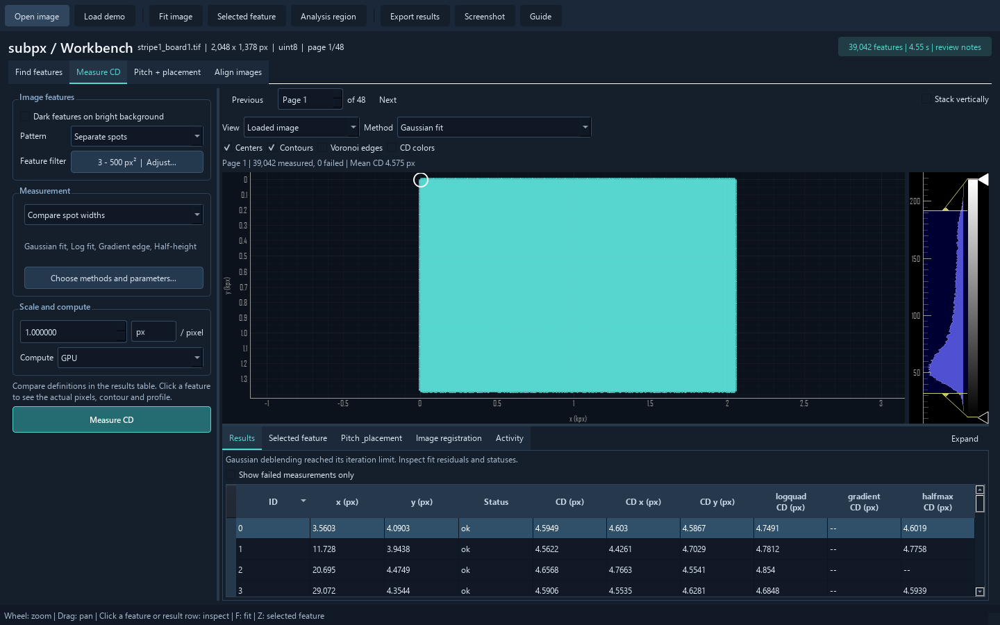

# Workbench UI/UX review and proposed structure

Reviewed 2026-10-31: `subpx/workbench.py` and `subpx/_workbench_data.py` as in the working tree that day (uncommitted
changes on top of 5d61ece). Line numbers below refer to that version.

## 1. Summary

**What was tested.** Every task (Find features, Measure CD, Pitch + placement, Align images), every dialog, error
cases and the minimum window size, on the demo image and on a page of your size (2048 x 1378 px, 39,042 holes,
`artifacts/cd_test/data/stripe1_board1.tif` page 0), on this PC's GPU; afterwards a short check on the synthetic sample
(`examples/data/synthetic_ch/contact_holes.tif`, 2,805 holes). A second, independent review was checked and merged.

**The five problems that matter most**

1. **It is not set up like your batch.** 9 of the batch's 10 methods are in no preset, the area limit differs (500
   vs 200), compute starts on CPU (about 8 minutes for one of your pages instead of 4 s on the GPU, with no cancel),
   and nothing is remembered: to see the batch's numbers you tick 9 methods and fix the limits by hand in every
   session.
2. **Failures are hidden.** The default methods Gradient edge and Half-height fail on 94 % and 74 % of the holes of
   your page, while the screen says "39,042 measured, 0 failed" (it counts only the method shown).
3. **It is too slow, too cluttered and too memory-hungry at your scale.** Clicking a hole takes 0.9-2.0 s. At full
   view the markers cover the whole image as a solid block (picture below). Every measured page keeps about 0.5 GB.
4. **The table and the hole detail take turns in the same place.** Clicking a row hides the table; checking ten
   holes means ten trips back.
5. **Tasks and pages do not keep their state.** After Find features, the Measure CD tab shows the Find features
   results. Changing page resets the zoom, the region and the selected hole, and drops the image being aligned, so
   one area cannot be followed through pages.



**Proposed structure (one window, everything linked by one selected hole)**

```
+----------------------------------------------------------------------------------------------+
| File  View  Run  Help   stripe1_board1.tif  page 94 [<][>]  2048x1378 uint8   GPU            |
+--------------+----------------------------------------------------+--------------------------+
| SETUP        |  [Fit] [Zoom to hole] [Region]  Show: image v      | HOLE 19522  (11.8, 692.6)|
|  Image    ok |  Color: CD of "Projection" v   4.40 [====] 5.34 nm | [<] [>]  [< failed >]    |
|  Holes    ok |                                                    | method      CD   status  |
|  CD methods  |            IMAGE                                   | * Gaussian  4.55  ok     |
|   changed !  |   full view: cells colored by CD, failures red     | * Projection 4.62 ok     |
|  Pitch    -  |   zoomed in: centers and contours of visible holes | * Edge area  --  failed  |
|              |                                                    | [raw pixels][input+contours]
| [Measure CD] |                                                    | profile plot             |
| PAGES        +----------------------------------------------------+ > Metrics  > Definition  |
|  list with   | [Holes table] [CD distribution] [Pitch] [Log]      |                          |
|  thumbnails  |  Results are from earlier settings. [Re-run] [Revert]                         |
+--------------+----------------------------------------------------+--------------------------+
| x=11.8 y=692.6 I=142 | Measuring CD 62 % [Cancel] | Gradient edge: 36,774 failed (94 %)     |
+----------------------------------------------------------------------------------------------+
```

- The **image** stays in the middle; the **selected hole** is always shown on the right; the **holes table** below
  never disappears when you click.
- **Setup** lists the steps once, in order (image, holes, CD methods, pitch), each with "ok / changed / not run".
- **Defaults = the batch's defaults** (methods, area limits, GPU), remembered between sessions.
- **Failures per method** are always on screen; every hole can be stepped through with the keyboard.
- **Pages**: a page list to move through pages, and "Stack vertically" kept and made to handle many pages; pages
  counted from 0 like the batch; zoom, region and selection stay when the page changes.
- **Align images** gets its own view where the comparison fills the main image area.

**Build order** (section 5): P0 fixes in the current window (no new layout), P1 speed and memory at 40k holes, P2 the
new layout; P3 (opening a batch run) later. **Decided** (section 6): pages counted from 0; the page list and "Stack
vertically" both stay; batch runs later, the goal now is an inspection UI for testing on sample images.

## 2. How this was reviewed

- Screenshots of 27 states, taken offscreen (`QT_QPA_PLATFORM=offscreen`, `QT_QPA_FONTDIR=C:/Windows/Fonts`; without
  the font folder every letter is a box). Seven are kept in `docs/images/workbench_review/`.
- Timings on the 39,042-hole page with `scripts/workbench_timing.py` (GPU, RTX 4060 Ti, two runs):

  | Action | Time |
  |---|---|
  | Measure CD, default 4 methods, in the window (about 1 s of it is redrawing afterwards) | 5.7-6.3 s |
  | Same 4 methods, direct call after warm-up / your batch's 10 methods, area <= 200 | 3.9 s / 8.0 s |
  | Same 4 methods on the default CPU setting (measured once, other jobs running) | 508 s |
  | Select a hole (click) | 0.9-2.0 s |
  | Switch method | 0.6-1.0 s |
  | Toggle CD colors / Voronoi edges | 1.9-2.3 s / 0.43 s |
  | One repaint at full view (each pan/zoom step) | 0.53-0.57 s |
  | Memory after measuring 1 / 2 / 3 pages | 1.3 / 1.8 / 2.2 GB |

- Failures on that page: default preset Gradient edge 36,774 (94 %), Half-height 29,021 (74 %), both
  `incomplete_rays`; Gaussian and Log fit 0. Your batch's 10 methods: projection 2,048 (5 %), foot_area 471,
  foot_area_ratio 430, tail_area_norm 23, tail_area 9.
- Synthetic sample (256 x 768, 2,805 holes): Measure CD 2.7 s in the window (first GPU run), select a hole 0.19 s,
  switch method 0.09 s; no failures with the default preset or the batch's 10 methods; at full view the markers
  cover it the same way (B1). Small samples are fast enough today; the speed work (P1) is for pages of your size.
- Small behaviour checks (results in section 3): PageDown in the table, arrow keys in the table, disabled-button
  colours, the registration error value, the tab label text, the sort arrow, padding 5 vs 3.
- The second review (no access to these findings) listed 54 items, most of them the same. Its new items were checked
  in the code or by a test before merging; numbers that only it measured say "(second review)".

## 3. Issues

Severity: **critical** = blocks real use, **major** = slows every session or misleads, **minor** = friction or polish.
Each item: what happens (evidence) -> fix direction.

### A. Fit to your data and workflow

- **A1 critical. The batch's settings take manual work in every session.** Workbench: area 3-500, CPU, methods
  gaussian / logquad / gradient / halfmax (`workbench.py:415`, `:458`, `:43-47`). `cd_batch.py`: area 3-200, GPU,
  10 methods (gaussian, projection, half_area, half_area_min, half_area_min_avg, tail_area, tail_area_norm,
  edge_area, foot_area, foot_area_ratio), `--deblend-tolerance` (not in the workbench). Components of 200-500 px2
  (blobs) are measured here and dropped by the batch, so such a page gets another hole list. (Padding 5 here vs 3 in
  the batch changes no CD: checked for 4 methods on the 39,042-hole page.) -> A "Batch default" preset equal to
  `cd_batch` (a test pins it to `scripts.cd_batch.ALL_METHODS` and its option defaults). Reading a batch run's
  `run.json` comes later (P3).
- **A2 critical. The default preset fails on most of your holes, and the screen hides it.** See section 2. The summary
  counts the shown method only (`:1424-1428`); only the first note is shown (`:1269`), so "gradient: incomplete_rays
  (36774)" sits behind "Gaussian deblending reached its iteration limit" (`before_full_view_39k.png`). -> Per-method
  failed counts always visible; default preset = batch default.
- **A3 major. "Calibrated hole diameter" (disk, flux_ratio) is one of only three presets** (`:46`), although both
  need a nominal CD or PSF and were ruled out for these images. -> Drop it from the presets; the methods stay
  selectable in the full list.
- **A4 major. Nothing is remembered between sessions**: pixel size, unit, polarity, methods, limits, compute, window
  layout, last folder (no `QSettings` anywhere). -> Persist all settings; "Reset to defaults".
- **A5 major. Page numbers start at 1** ("Page 95", `:681-686`) **while `pages.csv`, `--pages` and `--reference-page`
  start at 0** ("page 94"); `source.json` exports start at 0 again. Going from a batch row to the workbench is off by
  one. -> Count pages from 0 everywhere, like the batch (decided, section 6).
- **A6 critical. Compute defaults to CPU** (`:458`) even when the GPU works: Measure CD on your page took 508 s
  instead of 3.9 s, with no progress, no cancel and a window that refuses to close meanwhile. -> Default "Auto".
- **A7 minor. Hidden and false links between the tasks.** Threshold and padding feed CD (`_workbench_data.py:208-211`)
  but are hidden in the Measure CD task (`workbench.py:349-351`). "Refine center" carries the hint "These settings
  also feed CD measurements" (`:491`), yet CD ignores it (`docs/workbench.md:105-106`). -> Show exactly the settings
  each run uses (Setup steps, 4.3).

### B. Speed and memory at your scale (39,042 holes)

- **B1 critical. At full view the overlays cover the image.** Centers + contours paint a solid block; with CD colors a
  solid gold block (no level of detail; `:1394-1403`, `:1385-1393`). -> Far out: one raster with each cell colored by
  its CD (`values[cell_labels]`) and failures in red; zoomed in: centers and contours of the visible holes only.
- **B2 critical. Every click rebuilds every overlay**, including the Voronoi boundary of the whole page:
  `select_feature` -> `_render_image` (`:1546`, `:1379-1383`). 0.9-2.0 s per click (up to 3.1 s with Voronoi edges and
  CD colors on, second review). -> Move only the selection marker; rebuild overlays only when the result, method or
  layers change.
- **B3 major. Pan/zoom runs at about 2 frames/s** (0.55 s per repaint at full view). -> B1.
- **B4 major. Method switch 0.6-1.0 s, CD colors 1.9-2.3 s.** The table is rebuilt as Python lists on every method
  switch (`:224-245`) and CD colors build 39k brushes (`:1390-1392`). -> Raster overlays; a NumPy-backed table model
  built once per result.
- **B5 major. No cancel, no progress.** Busy is a 180-px bar in the corner with no stage or elapsed time; closing is
  refused while a job runs (`:1916-1921`); a CPU run of one page took 508 s (section 2). -> Cancel (at first: stop
  waiting and discard the result; a real stop needs a check between CD stages) and stage progress.
- **B6 major. Every measured page stays in memory**: about 0.47 GB per 39,042-hole page, with no limit (1.3 -> 1.8 ->
  2.2 GB after 3 pages; `_page_reviews` and `_task_reviews`, `:1091`, `:1253`). Ten pages would take about 5 GB. ->
  Keep only the last few pages; drop arrays that can be recomputed.
- **B7 minor. Typing a hole number redraws on every keystroke**: the hole box tracks the keyboard (`:863-865`), so
  "150" causes three redraws of about 1 s each (second review). -> Keyboard tracking off, as in the page box.

### C. Layout and information architecture

- **C1 critical. The holes table and the hole detail share one tab area.** Clicking a row or a hole switches the
  bottom area to "Selected feature" and hides the table (`:1498-1499`; checked). -> Hole inspector in its own
  always-visible panel.
- **C2 major. Task tabs do not own their results.** They switch the left controls and the bottom tab, but the shown
  result is whatever ran last for that page: after Find features, "Measure CD" shows Method "detection" and the
  detection table (`before_task_switch.png`; `:354-356`). -> One result set per page; steps add layers and never
  replace each other's display.
- **C3 major. The layout jumps under the mouse.** A click enlarges the bottom panel and shrinks the image by about a
  quarter, overriding a size the user set (`:1500-1503`). -> Panel sizes only change when the user drags them; sizes
  are remembered.
- **C4 major. Space goes to the wrong things.** About 250 px of controls sit above the image (toolbar, title, task
  tabs, page bar, view row, layer row, summary). At 1440 x 900 the image gets about 380 px of height, the hole crops
  about 170 px and the table 5-8 rows, while the settings column is mostly empty below its button. At the minimum
  1024 x 680 the image is about 120 px high and the method comparison shows 2 rows (`before_selected_hole.png`,
  `before_min_size.png`). -> Section 4 layout; Setup can collapse.
- **C5 major. Settings repeat and appear in inheritance order.** Pitch shows the CD preset and the scale before its own
  settings; Measure CD shows feature settings; "Feature filter 3 - 500 px2 | Adjust..." is a button that switches the
  whole task (`:428-429`). -> One Setup panel in pipeline order; each setting appears once.
- **C6 major. Key results sit in small grey hint text**: the registration shift in the controls column, the pitch
  summary as one dense line, the CD summary as one line above the image. -> Results in result areas, large and
  plain.
- **C7 major. Dialogs hold core information.** Methods dialog: 19 methods in one flat list with long labels, a
  horizontal scrollbar, faint unchecked boxes, no select all / none, parameter groups that appear and disappear as
  you tick (`before_methods_dialog.png`). Metrics dialog: raw keys, no units, no hole or method named. Indexing
  dialog: 550 x 620 px for three fields (`:547`), apart from the lattice setting it belongs to. Method definition and
  Guide: message boxes (`:885`, `:1893`). -> Inline sections (Setup, inspector).
- **C8 minor. The title row "subpx / Workbench" uses about 40 px of height** and repeats the window title (`:306`).
- **C9 minor. Empty states show empty plots with meaningless axes** (0 to 1, "mpx") and table filters before any
  result. -> A one-line message with the next action.
- **C10 minor. The main image area is idle in Align images**: it shows the reference only; the comparison is in three
  small images below. -> Align view (section 4.8).
- **C11 minor. The Run button can scroll out of sight.** It sits inside the scrolling settings column; at 1024 x 680
  the Pitch button, and the CD button once many methods are ticked (their names fill a long paragraph), are below the
  visible part (second review). -> Pin the Run button under the steps.

### D. State, feedback and errors

- **D1 major. A disabled main button looks enabled.** `QPushButton#primary` outranks `QPushButton:disabled` in the
  style sheet (`:915-916`): same fill #246c72 and white text when disabled (measured), e.g. Measure CD with the
  calibrated preset and no calibration. Disabled checkboxes (Contours during Find features) look active too. ->
  Explicit disabled styles; the reason shown under the button, not only in its tooltip.
- **D2 major. Stale results do not look stale.** After a setting changes only the small status pill says "Settings
  changed" (`:932-934`); there is no way back to the settings that produced the results. -> Banner over the results
  with "Re-run" and "Revert"; per-step "changed" marks in Setup.
- **D3 major. Bad input is accepted and then reported as a Python traceback.** Area 600 to 500 is accepted, Run stays
  enabled, the run fails with a traceback and the bottom panel jumps to Activity, hiding the results
  (`before_error.png`; `:1008-1016`). Same for one of two pitch values; an unreadable TIFF shows "TiffFileError...".
  -> Check fields as they are typed; disable Run with the reason; plain one-line error, details in the log, results
  stay visible.
- **D4 major. Routine notes are alarms, real failures are hidden.** The pill says "review notes" for "204 components;
  204 pass area limits" (`:1266-1267`), while a 94 % failure is not shown (A2). -> Notes with a level (info /
  warning); failures per method in the summary line.
- **D5 minor. Status messages vanish.** Moving the mouse over the image replaces "Saved: ..." or an error with the
  hover readout (`:1491`); an old error stays after a later success (`before_min_size.png`). -> Hover readout in its
  own permanent field; clear errors on success.
- **D6 minor. Raw status codes** ("incomplete_rays") in the table and inspector, without explanation. -> Plain text
  plus a tooltip.
- **D7 minor. One pill shows everything in one colour**: busy, ready, failed, settings changed, registered, exported,
  all teal (`:910`). The log shows timings as a Python dict with 16 digits. -> Separate job status, result summary and
  pending changes, coloured by severity; formatted log.
- **D8 minor (no failing case found yet). Errors outside background jobs would be invisible** when started as
  `subpx-workbench`: it is a GUI script without a console, and an exception in a click or redraw handler only goes to
  stderr. -> An exception hook that writes to the log and shows the error banner.

### E. Interaction and navigation

- **E1 major. PageUp/PageDown are window-wide**: with the table focused, PageDown loads the next page (and its empty
  result) instead of scrolling (`:679-680`; checked: page 0 -> 1). -> Only when the image or the page list has focus.
- **E2 major. Arrow keys move the table row but do not select the hole** (only mouse clicks, `:851`; checked). ->
  Follow the current row.
- **E3 major. Rays are inspected one at a time by number** (spin box 0-95, `:774-779`); nothing shows which rays
  failed. -> Polar plot of the edge radius for all rays; click a ray there or on the input crop.
- **E4 minor. Hole 0 is pre-selected after every run** (white ring, `:1105`, `:1265`). -> No selection until a click.
- **E5 minor. "Next failed" goes forward only, for the shown method only** (`:1552-1561`). -> N / Shift+N; "failed
  in any method" filter.
- **E6 minor. The analysis region** has one resize handle (added twice at the same corner, `:731-732`), no numeric
  bounds and its switch sits in the toolbar far from the image. -> Handles on all corners; editable x0 y0 x1 y1.
- **E7 minor. Toolbar "Selected feature" zooms** (`:293`) but reads like a view, and a bottom tab has the same name.
  -> "Zoom to hole (Z)".
- **E8 minor. Find features switches the view to "Threshold mask" by itself** (`:1294-1295`). -> Keep the user's
  view; the mask is a layer.
- **E9 minor. No menus, recent files, drag-and-drop or right-click menus** (copy a value, copy rows); "Load demo" and
  "Screenshot" take toolbar space; Open always starts at the first page. -> File menu with recent files, drop to
  open, table context menu.
- **E10 major. Selecting a hole from the table does not bring it into view**: the view never moves (`select_feature`),
  so a hole outside the current zoom stays off-screen. -> Pan, keeping the zoom, when the hole is outside the view.
- **E11 minor. Shortcuts are hard to find and partial.** Toolbar tooltips are bare ("Fit image"); F and Z appear only
  in the status hint that the first hover overwrites; Ctrl+Enter works with the main Enter key but not the keypad
  (`:333`); no keys for next hole, layers or tasks; no zoom readout, 1:1 button or scale bar. -> Shortcut in every
  tooltip and menu entry; keys of 4.10.

### F. Naming, text and visuals

- **F1 major. Each method has up to three names**: keys in the table and inspector ("logquad"), short names in the
  method box ("Log fit"), library labels in the methods dialog ("Gaussian FWHM", next to "Deblended Gaussian FWHM"
  for the other Gaussian). Only 8 of 19 methods have a short name (`:48-50`, `:235`, `:1526`, `:566-569`). -> One
  display-name table in the workbench for all 19 methods (library keys and labels unchanged; keys in tooltips and
  exports).
- **F2 major. The table's columns move and squeeze.** The shown method's columns are unnamed ("CD (px)") and come
  first, so the column order changes with the method box. All columns stretch to equal width; with many methods they
  shrink to about 43 px and cannot be resized (second review) (`:232-235`, `:850`). After a method switch the sort
  arrow still marks the old column while the rows are back in ID order (checked). -> Fixed order, method names in
  headers, compact resizable columns, sort kept.
- **F3 minor. The tab "Pitch & placement" reads "Pitch _placement"** ('&' marks a keyboard shortcut, `:815`), while
  the task is called "Pitch + placement". -> "&&", one name.
- **F4 minor. Pixel axes get unit prefixes**: "x (kpx)", "y (mpx)", "Placement error (mpx)", and "mnm" when the unit
  is nm (second review). -> Turn off pyqtgraph's automatic SI prefix on these axes.
- **F5 minor. CD colors run from the smallest to the largest CD** (one outlier washes out the rest), with no colorbar
  and no fixed range for comparing pages (`:1388-1393`). -> Colorbar, 1-99 % range by default, lockable range.
- **F6 minor. The same colour means many things.** Teal: centers, Voronoi edges, the first method's contour, the
  active page, selection, buttons. Gold: the region, x pitch links, the Log fit contour and its fit support (`:31`,
  `:1382`, `:1396`). The 7 method colours repeat beyond 7 methods (`COLORS[i % 7]`), so contours become ambiguous.
  -> Fixed colour roles; distinct method colours.
- **F7 minor. Hole crops hide data**: the cell outline is a pixel-wide band painted over the pixels; plot legends sit on
  the curves; plot fonts differ from the window font (`before_selected_hole.png`). -> Thin outline on pixel edges;
  legends out of the data.
- **F8 minor. Long help texts with internal terms** (hints under every group, the Guide box, method definitions).
  -> Short labels, details on hover.
- **F9 minor. "1.000000 [px] / pixel"** reads oddly; the unit is free text (`:446-457`). -> "Pixel size [21.0] [nm v]".
- **F10 minor. Labels are cut** ("Reference at selected featur"); the settings column cannot be wider than 345 px
  (`:407`).
- **F11 minor. Display contrast is re-stretched on every page** (1-99.5 %, `:148-156`), so pages cannot be compared by
  eye, and there is no reset or lock.
- **F12 minor. "Registration" means two things.** The pitch plots call placement error "X / Y registration" (the
  mask-metrology meaning, `:811`), while "Image registration" (tab) and "Align images" (task) mean aligning two
  images. -> "Placement error" in the pitch plots, "Align" for image alignment.
- **F13 minor. Spin boxes show no step arrows** (e.g. the area limits in `before_task_switch.png`; the style sheet
  restyles spin boxes at `:919` but not their buttons), so nothing shows that values can be stepped.

### G. Pages and files

- **G1 major. "Stack vertically" does not scale.** It decodes every page up front and draws all of them at full
  resolution (`_workbench_data.py:129-147`); Fit shows the whole stack, so 48 pages become a strip about 90 px wide
  (`before_stack_48_pages.png`). A 720-page (2 GB) file added 1.9 GB of memory, 2,163 items redrawn on each update and
  2.4 s per click (second review). -> Keep it next to the page list (decided, section 6): pages decoded when they come
  into view, drawn at reduced resolution when zoomed out, memory capped; F fits the active page, Shift+F the stack.
- **G2 minor (the workbench was not timed on the HDD). Each page change reopens the TIFF and counts its pages**
  (`_workbench_data.py:111-115`), which walks every page header: 0.04 s on the 48-page test file, 7 ms for 720 pages
  on a warm SSD (second review). On this PC's HDD the first walk of a 740-page file's headers took 4.9-5.2 s cold,
  then 0.1-0.3 s (batch notes, `tasks/archive/todo-2026-10.md`). -> Keep the file open; read the page table once.
- **G3 minor. No overview of pages**: which have holes (no hole-check result), which were measured here. -> Page list
  (batch values when a run is loaded: P3, later).
- **G4 major. A page change resets the view.** Zoom goes back to fit, contrast is re-stretched, the analysis region is
  switched off and re-centred, the bottom tab returns to Results and the selection to hole 0 (`:1105`, `:1115`,
  `:1138-1145`, `:148-156`). One area cannot be followed through pages. -> Keep zoom, region, tab and the selected
  position across pages; keep contrast when locked.
- **G5 minor. No page marks or "measure and next".** Pages show no measured / failed mark; the page bar appears only
  for multipage files and shifts the layout by about 40 px; "Previous" / "Next" look like plain labels
  (`before_full_view_39k.png`).

### H. Align images

- **H1 major. "Phase-correlation normalized error" is always 1.0** (scikit-image's default phase normalization):
  1.0 for a perfect shift and 1.0 for unrelated noise (checked; `workbench.py:1808`). Unrelated pages still report
  "Registered | dy=-326.05 ..." in the normal pill (second review). -> Show the batch's hole-check error instead
  (`pcc_error` in `scripts/cd_batch.py`, same mode and threshold) and warn when it fails.
- **H2 minor. The correlation image does not show the peak**: no mark on the chosen peak, and its 1-99.5 % contrast
  hides it (on a real pair the peak is only 1.8 times the 99.5 % level, second review). With a repeating pattern the
  runner-up peaks are what matter. -> Zoom to the peak; mark the best and second-best peaks.
- **H3 minor. Only small, unlinked side-by-side images**; no flicker, swipe or checkerboard, the quickest ways to see a
  shift; the difference images have no colorbar (zero is pale and looks blank). -> Align view (4.8).
- **H4 minor. "Overlap RMSE: 13.804 > 0"** uses ">" as an arrow (`:1807`). -> "13.8 -> 0.0".
- **H5 major. Changing the page drops the moving image and the alignment** (`:1103`): aligning several pages to one
  reference means reopening the moving file each time; another page of the same file needs the file dialog, and the
  moving-page box is stuck at 1-1 until then (`:524`). -> Keep the moving image; "use page N of this file".
- **H6 minor. "Analysis region" stays visible and enabled in Align images**, where it is ignored. -> Hide it there.

### I. Pitch

- **I1 minor. "Measure pitch" with CD centers silently re-measures CD** when the last CD result does not match the
  settings (`:1226-1246`). -> Say so before running ("needs Measure CD first").
- **I2 minor. The pitch method is chosen with the image's method box; the summary shows internal values**
  ("selected_pair_mean", `:1759-1762`). -> Method choice and plain summary inside the Pitch tab.
- **I3 minor. Four small plots (about 120 px high)**; a point cannot be clicked to find its holes. "Pitch pairs"
  switches itself on after a run and covers the image at full view (`:1291`). -> Larger plots; click a point to select
  its pair on the image; pairs drawn only when zoomed in.

### J. Export and session

- **J1 minor. Export writes the active page's last result to an auto-named folder** (`:1846-1883`), asking for the
  parent folder every time; no choice of contents, no CSV of the table as shown, no copy to the clipboard. CD +
  alignment of one page took 8.8 s and 137 MB (second review). -> Export dialog; "Copy rows".
- **J2 minor. Results are lost without asking**: opening another file discards every page's results; closing the
  window too. -> Ask first when results exist; saving a session can come later.

## 4. Proposed structure

### 4.1 Rules

1. **Overview, list, detail, linked.** Image (where), holes table and CD distribution (which), hole inspector (why).
   One selected hole and one current method drive all of them; none hides another.
2. **One page = one set of results.** Holes, CD and pitch of a page live together; looking at one never replaces
   another. Moving between pages keeps what you look at (zoom, region, selected position).
3. **Same defaults as the batch.** The batch's methods, limits and GPU by default; settings remembered. Reading a
   batch run comes later (P3).
4. **Failures first.** Failed counts per method always visible; failed holes one key away.
5. **Interactive at 40k holes.** Click < 0.1 s, method switch and layer toggles < 0.2 s, repaint at full view
   < 0.05 s; memory bounded.
6. **One name per thing**: one display name per method, one word for features or holes (the batch says "holes"),
   pages counted from 0.

### 4.2 Window

Dock widgets (`QDockWidget`) around the image; layout saved in `QSettings`; Ctrl+1/2/3 show or hide Setup, Inspector,
bottom panel. At 1440 x 900: left 280 px, right 380 px, image about 780 x 560 px, bottom panel 260 px under the image
only. At 1024 x 680 Setup starts collapsed. Header: one slim line with file, page navigation, image size and type,
compute device. Status bar: hover readout (permanent field) | job progress with Cancel | result summary.

### 4.3 Setup panel (left)

Collapsible steps in pipeline order, each with a status mark (not run / ok / changed) and its own Run button, pinned
under the steps so it never scrolls away; Ctrl+Enter runs the open step.

1. **Image**: pixel size + unit (one field), polarity, compute (Auto / GPU / CPU).
2. **Holes**: pattern (separate / touching), threshold, area min-max (checked live, with an area histogram showing the
   limits), padding. "Preview holes" runs detection only (today's Find features); its threshold mask, labels and
   rejected boxes are image layers.
3. **CD methods**: preset (Batch default / Spot widths / Raw cell / Custom); methods grouped (spot fits, radial edges,
   projections, area methods, raw-cell methods, calibrated) with a short name and one line each, select all / none;
   "Parameters" folds out the parameters of the ticked methods only.
4. **Pitch**: centers of which method, lattice, averaging, design pitch; "Advanced" folds out hints and stagger
   direction (replaces the indexing dialog).

A tab next to Setup holds the **Pages** list (4.7).

### 4.4 Image

- Layers: image or a pipeline stage ("Show": image, threshold mask, labels, cells, background model), CD color map,
  failures, centers, contours (current method or all), Voronoi edges, pitch pairs, region. A layer toggles without
  recomputing others.
- Level of detail: with more than about 2,000 holes in view, raster maps only (cell colored by CD, failed cells red);
  closer in, centers, contours and pitch pairs of the holes in view only (vectorized clip by the view rectangle).
- Colorbar on the image: 1-99 % range by default, drag to set, lock to compare pages.
- Selection: a marker layer of its own; selecting never redraws other layers; an off-screen selection pans into view.
- Scale bar and zoom readout; an overview inset when zoomed in (optional).

### 4.5 Hole inspector (right, always visible)

- Header: hole number, position, page; previous / next (table order) and previous / next failed.
- Method table: colour dot (= contour colour), short name, CD, x, y, status in plain words. Click a row = current
  method.
- Two crops side by side: original pixels with a thin cell outline; method input with every method's contour, the
  current one thick (toggle "current only").
- Profile plot for the current method (row profile, rays with the all-rays polar plot, x/y projection).
- Folding sections: Metrics (readable names, units) and Definition (method help).

### 4.6 Bottom panel (under the image)

- **Holes table**: fixed column order (methods in Setup order, display names), compact resizable columns, sortable,
  filters (failed in the current method / in any method), ID search; the selection follows the keyboard and mouse
  both ways; right-click copies values or rows. After "Preview holes" it lists area and kept / rejected.
- **CD distribution**: histogram of the current method with failed count; dragging a range filters the table and
  highlights those holes on the image.
- **Pitch**: method choice, plain summary, larger plots; clicking a point selects its pair.
- **Log**: activity, formatted timings, full tracebacks (never opened automatically).

### 4.7 Pages

Both ways of moving through pages stay (section 6), linked: the list follows the stack and the stack follows the list.

- **Page list**: page number counted from 0, small thumbnail made on demand, marks for "measured here" and failures.
  PageUp / PageDown when the image or list has focus; optional "Measure and next page".
- **Stack vertically**: all pages in one view, as today; analysis runs on the active, outlined page and clicking a
  page makes it active. Pages are decoded when they come into view and drawn at reduced resolution when zoomed out
  (full resolution only for pages in view), with a memory cap. F fits the active page, Shift+F the whole stack.

The TIFF stays open with a small cache of decoded pages; results are kept for the last few pages only. Zoom, region,
bottom tab and the selected position stay when the page changes; contrast stays when locked. With a batch run (P3,
later) the list adds status, holes, mean CD and hole-check error.

### 4.8 Align view

A second view (header switch "Measure | Align"). The main image area shows the comparison at full size: flicker
(Space toggles reference / aligned), difference before / after with a colorbar, checkerboard, blend. The right panel
shows the shift in large type with its meaning ("move the moving image by dy, dx"), RMSE before -> after, the batch's
hole-check error with a warning when it fails, and the correlation surface zoomed around the peak with the best and
second-best peaks marked. The moving image can be any page of any file, including the open one, picked from a page
list, and stays when the reference page changes.

### 4.9 Feedback rules

- Disabled controls look disabled; a disabled Run shows its reason under it.
- Fields are checked as typed (red border, one-line message).
- Changed settings: banner over the results ("Results are from earlier settings: area max 500 -> 200. Re-run |
  Revert"), "changed" mark on the step.
- Job errors: one plain line in a banner with "Details" (opens the log); results stay visible. An exception hook sends
  errors from handlers to the same banner.
- Status coloured by severity (info / warning / error); notes have a level; the summary line lists failures per
  method.
- Opening another file or closing asks first when results exist.

### 4.10 Keyboard and mouse

| Key | Action |
|---|---|
| Ctrl+O, drop a file | open |
| Ctrl+Enter (either Enter key) | run the open Setup step |
| F / Shift+F / Z | fit the page / fit the whole stack / zoom to the selected hole |
| Up / Down in the table, or J / K | previous / next hole in table order |
| N / Shift+N | next / previous failed hole (current method) |
| PageUp / PageDown | previous / next page (image or page list focused) |
| Esc | cancel the running job |
| Ctrl+C | copy the selected hole's values or the selected rows |
| Space (Align view) | flicker reference / aligned |

Mouse: click a hole = select; wheel = zoom; drag = pan; right-drag on the image = draw the analysis region. Every
toolbar button and menu entry shows its key.

### 4.11 Code structure

`workbench.py` is one 1,970-line window class whose methods call each other directly; that is why a click redraws
everything and why the shown result belongs to no task. Proposed package (entry points `subpx.launch_workbench`,
`python -m subpx.workbench` and `subpx-workbench` unchanged):

```
subpx/workbench/
  __init__.py      launch_workbench, main; __main__.py for python -m
  session.py       Session(QObject): open file + page cache, page, settings, results per page (last few pages),
                   selected hole, current method; signals page_changed, results_changed, selection_changed,
                   method_changed, settings_changed (with which steps are now stale), job_* signals
  settings.py      settings dataclass, validation, QSettings load/save, presets (run.json import later, P3)
  names.py         display names and one-line descriptions of methods, statuses and metrics
  jobs.py          one worker, progress, cancel (discard), errors as plain text + traceback
  canvas.py        image view with layers and level of detail
  window.py        main window: menus, header, docks, wiring panels to the session
  panels/          setup.py, pages.py, inspector.py, holes_table.py, distribution.py, pitch.py, align.py, log.py
  data.py          today's _workbench_data.py (Qt-free), plus raster maps and the batch's hole-check error
```

Panels never call each other; they listen to the session. No library change is needed; CD numbers do not change.

## 5. Implementation phases

Each phase ends with the tests passing (`$env:QT_QPA_PLATFORM = "offscreen"; pytest tests/test_workbench*.py`),
`scripts/workbench_timing.py` run on the 39,042-hole page, screenshots compared, `docs/workbench.md` updated,
commit + push.

**P0. Fixes in the current window** (no new layout)
- [x] D1 disabled styles (main button, checkboxes) and the reason under the button; F13 visible spin-box arrows
- [x] F3 "Pitch && placement" and one task name; F4 no SI prefixes on pixel axes; H4 arrow text; F12 "Placement
      error" vs "Align"
- [x] E1 PageUp/PageDown scoped to the image and page bar; E2 table keyboard selection; E10 pan to an off-screen
      selection; B7 hole box keyboard tracking off
- [x] C1 interim: clicking a table row keeps the table visible (only image clicks open the hole tab)
- [x] A2 / D4 summary shows failed counts per method; notes listed with a level
- [x] D3 live checks (area limits, pitch pairs), Run disabled with reason, plain error, no jump to Activity; D8
      exception hook to the log
- [x] D5 hover readout in a permanent status field
- [x] H1 replace the always-1.0 error with the batch's hole-check error; H5 keep the moving image when the page
      changes
- [x] G4 keep zoom, region, bottom tab and selected position across pages
- [x] A1 / A3 / A6 "Batch default" preset (test pins it to `scripts.cd_batch`), calibrated preset removed from
      presets, compute default Auto
- [x] A4 settings and window layout saved with `QSettings`; "Reset to defaults"
- [x] F1 one display-name table for all methods, used everywhere
- [x] E4 no pre-selected hole; A5 pages counted from 0 (page box, page labels, hover, status line, exports)
- [x] E9 (part) drop a file on the window to open it (testing many sample files)

Done when: tests cover each fix (style differs when disabled, PageDown in the table keeps the page, arrow keys select,
failed counts shown, zoom and region survive a page change, settings survive a new window, batch preset equals
`cd_batch`).

**P1. Speed and memory at 40k holes**
- [x] B2 selection marker separate from the overlays; overlays cached per result, method and layer
- [x] B1 / B3 raster maps far out, visible-holes-only vectors close in; F5 colorbar and range
- [x] B4 NumPy-backed table model built once per result; filters and sort by index arrays; F2 sort kept
- [x] B6 results kept for the last few pages only
- [x] G1 Stack vertically: pages decoded when in view, reduced resolution when zoomed out, memory cap; F / Shift+F

Done when, on the 39,042-hole page: click < 0.1 s, method switch < 0.2 s, layer toggle < 0.2 s, full-view repaint
< 0.05 s, memory stops growing after the page limit, and the full-view screenshot shows the image with a CD map
instead of a solid block. Stack vertically on the 48-page test file: click < 0.1 s, repaint < 0.05 s, and memory
does not grow with the number of pages beyond the reduced previews.

**P2. New layout**
- [ ] Session object and package split (4.11); tests moved to the new widgets
- [ ] Docks: Setup steps with status marks and a pinned Run button (4.3, C11), hole inspector (4.5), bottom tabs
      (4.6); dialogs removed (C7)
- [ ] Stale banner with Re-run / Revert (D2); Cancel and stage progress (B5)
- [ ] Page list next to "Stack vertically", the two linked (4.7, G5); TIFF kept open (G2)
- [ ] Align view (4.8); Pitch tab with method choice and clickable points (I1-I3)
- [ ] Menus, recent files, drop to open, shortcuts in tooltips, table right-click menu (E9, E11); export dialog and
      copy rows (J1); ask before discarding results (J2)

Done when these walk-throughs work by keyboard and mouse as described, each checked with a screenshot:
1. Drop a sample on the window (the 48-page test file), pick page 5 in the page list, measure with the batch's
   methods, see the failures per method, step through 10 failed holes with N without touching the table.
2. Change area max 200 -> 150: banner appears; Revert restores; Re-run updates.
3. On one hole, compare all methods: colours in the method table match the contours; clicking a method changes the
   profile.
4. Zoom into one corner, go through five pages: the view stays on that corner.
5. Pitch from the current CD without a hidden re-measure; click a placement point to find its holes.
6. Align three pages in turn with one reference page: flicker on the main image; shift and hole-check error shown;
   the moving image is never reopened by hand.
7. Turn on Stack vertically on the 48-page file: Shift+F shows the whole stack, F the active page; clicking another
   page makes it active and the page list follows.

**P3. Open a batch run (later, decided 2026-10-31)**
- [ ] Open a `cd_batch` output folder: settings from `run.json`, page list from `pages.csv`; "Load settings from
      batch run" in Setup
- [ ] Measure a listed page with the run's settings and show the batch mean next to the workbench mean (they should
      agree; a difference means different settings or code)

## 6. Decisions (answered 2026-10-31)

1. **Page numbers**: counted from 0 everywhere, like `pages.csv`, `--pages` and `--reference-page`.
2. **Pages**: both are needed, page navigation (the page list) and "Stack vertically". The stack stays and is made to
   handle many pages (4.7).
3. **Opening a batch run (P3)**: later. The goal now is an inspection UI for testing interactively on sample images.

Not changed by this plan: CD methods and their numbers, method keys and library labels, `cd_batch`, the public
`launch_workbench` call.

## Appendix: reproducing the baseline

```powershell
.\.venv\Scripts\python.exe scripts\workbench_timing.py --out artifacts\workbench_timing
```

Prints the timing table of section 2 and the failed counts for the default preset, and saves two screenshots. For
other states, drive `InspectionWindow` the same way (`window.task`, `window.run_button`, `window.select_feature`,
...); offscreen on Windows needs `QT_QPA_FONTDIR=C:/Windows/Fonts`.
