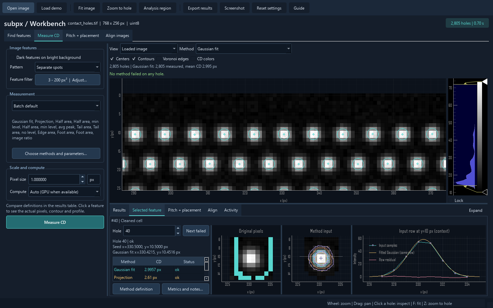
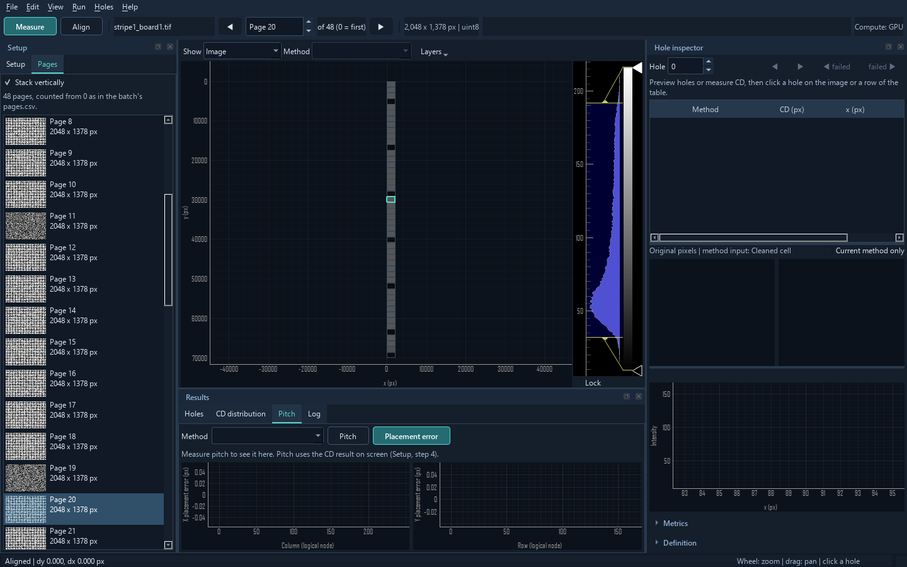

# Desktop inspection workbench

The PyQt6 application runs the repository's existing analysis methods and uses
pyqtgraph for every image, overlay and diagnostic plot. It is separate from the
OpenGL tiled notebook viewer in `subpx.viewer`.

From the repository root on Windows:

```powershell
.\.venv\Scripts\python.exe -m subpx.workbench --demo
.\.venv\Scripts\python.exe -m subpx.workbench path\to\image.tif
```

For a fresh installation:

```powershell
python -m pip install -e ".[analysis,viewer]"
subpx-workbench
```



Choose a task tab: **Find features**, **Measure CD**, **Pitch + placement** or
**Align images**. Its controls and named action stay beside the image; results
stay below it. **Ctrl+Enter** (either Enter key) runs the current task. A
disabled Run button says why directly under it (for example "Area min (300) is
above area max (200)"), and the field at fault gets a red border. Image overlays
and the contrast histogram are directly available beside the image.

**The defaults are the batch's defaults** (`scripts/cd_batch.py`): the
**Batch default** preset (its ten methods: Gaussian fit, Projection, Half area,
Half area min level, Half area min level avg peak, Tail area, Tail area no
level, Edge area, Foot area, Foot area image ratio), area 3-200 px², padding 3,
deblend iterations 30 and stop tolerance 0.001, and **Compute: Auto** (the GPU
when CuPy works). A test pins them to `cd_batch`, so the workbench measures a page
as the batch does. Two more presets compare **Spot widths** (Gaussian, log fit,
gradient, half-height) and **Raw-cell widths**. The calibrated methods (blurred
hole fit, flux ratio) need a nominal CD or PSF and are only in the full list of
**Choose methods and parameters**; only parameters of the ticked methods appear
there. Every method has one display name everywhere; its library key and label
are in tooltips and exports.

**Settings are remembered** between sessions (all controls, the task, the window
size and splitters, the last folder). **Reset settings** restores the defaults
above; the image and results stay.

The line above the image always lists the **failed holes of every method**
(e.g. "Failed: Projection 2,048 (5 %) · Foot area 471 (1 %)"), not only of the
method shown. The **Results** table lists the holes. Click a row, or move with
the arrow and Page keys, to select its hole; the table stays, and the image pans
(keeping the zoom) when the hole is outside the view. Click another method's CD
column to show that method. Clicking a hole on the image opens the **Selected
feature** tab with its original pixels, method input, contours and profile. No
hole is selected until you click one. **Metrics and notes** contains all
numerical diagnostics; **Method definition** explains assumptions.

Errors appear as one plain line in a red banner over the results, which stay
visible; **Details** opens the full message in **Activity**. Unexpected errors in
the window itself go to the same banner. Drop an image file on the window to open
it.

## Image review

- Open TIFF, PNG, JPEG, BMP or a two-dimensional `.npy` array. Multipage files
  reveal a navigation bar above the image. Use **Previous**, **Next**, the
  **Page** box, or **Page Up / Page Down** while the image or the page bar has
  focus (in the table they scroll the table). **Pages are counted from 0**, as in
  the batch's `pages.csv`, `--pages` and `--reference-page`.
- Changing the page keeps the zoom, the analysis region, the lower tab, the image
  view, the selected position (after measuring, the hole at that position is
  selected) and the moving image of **Align images**, so one area can be followed
  through the pages. Tick **Lock** under the histogram to keep the contrast too;
  otherwise each page is stretched to its own 1-99.5 %.
- Enable **Stack vertically** to display all pages together, in file order.
  Click any page to make it active; its outline turns teal. Pages may have
  different dimensions or numeric types. They are displayed separately, with
  space between them, rather than concatenated into one measurement image.
  Analysis, regions, feature selection, registration and export use the active
  page only. Overlays appear on that page. Hover reports the page number and
  coordinates local to that page. The image axes show the stacked layout's
  coordinates. **Fit image** fits all displayed pages.
- Stacking loads all pages in a background worker and caches them until another
  file is opened. Turning it off returns to the active page without discarding
  its measurements. Returning to a measured page restores its analysis. An
  alignment result resets when the reference page changes; the moving image stays.
  For files too large to hold all pages in memory, use individual-page mode.
  A multidimensional array within a single TIFF page must first be reduced to
  a two-dimensional or RGB(A) image.

- Grayscale data retain their original precision. RGB is converted to luminance
  with `0.2126 R + 0.7152 G + 0.0722 B`; alpha is ignored. The conversion is
  displayed beside the image name. Nonfinite and complex images are rejected.
  Boolean arrays are converted to uint8 with their 0/1 intensities preserved.
- Wheel to zoom, drag to pan, press **F** to fit and **Z** to zoom to the selected
  feature. Hover reports image coordinates and the original pixel intensity.
  The histogram adjusts display levels without changing data or measurements.
  Layer toggles preserve the chosen contrast.
- Toggle **Analysis region**, then move or resize the gold rectangle. The next
  analysis uses only that crop. Its boundaries can clip features, affect seed
  detection and exclude cells; review the region edges. Pixel centers have
  integer coordinates, x is the column and y increases down the image.
- In **Scale and compute**, set the pixel size and its unit together before
  measurement. The UI displays calibrated lengths and areas; original result arrays
  retain pixel units. Auto (the default) uses the GPU when available, as the batch.



## Find patterns

Choose **Find features**, adjust threshold, component area limits and center
refinement, then click **Find features**. The image view stays as you set it.
**Adjust** beside CD's feature filter takes you directly to this task.
Switch the image view to **Threshold mask** or **Component
labels** and enable **Rejected boxes** to see components outside the area limits.
Click the image or a measurement-table row to select a feature. The inspector
shows seed and refined coordinates; the lower tab shows original pixels,
segmentation and the center-row intensity.

Detection input is rescaled to uint8 when required by OpenCV (uint16 Otsu is
retained). The Activity tab records this conversion. This rescaling does not
replace the original image used for CD.

## CD and intermediate steps

Choose the **Measure CD** task and a measurement preset, then click **Measure CD**.
Select additional methods in **Choose methods and parameters**. All methods in
`subpx.cd.METHOD_LABELS` are available. Each has its existing prerequisites:
Gaussian and invariant methods require model background; disk/flux ratio require
nominal CD or PSF calibration. The Activity tab reports invalid combinations
without discarding the previous results. Local-only methods bypass deblending.
The detection refinement control applies to **Find features**; CD independently
constructs its own seed list using its selected threshold or peak pipeline.

Use **Contours**, **Voronoi edges**, **CD colors**, and the stage selector to
review the measurements on the image. Boundaries come from the actual raster
cell labels. CD colors run from the displayed purple minimum to yellow maximum
of the selected method's valid equivalent CDs. Red crosses identify failed
measurements at their seed positions; they remain selectable.

The inspector compares calibrated CD and status across methods. It also shows
the selected method's metrics, full cell area and mean original cell intensity.
**Next failed** and **Show failed measurements only** help review problems.
Failed measurements retain their status and NaN values, with no seed fallback.
Below the results table, warnings (failures per method and status, deblending
stopped at its iteration limit, no holes, pitch indexing failed) are listed in
amber, information (component counts, crops) in grey.

The **Selected feature** tab shows original pixels, the method's input and
overlaid method contours. The emphasized contour is the selected method.

- **Gaussian:** input row, fitted Gaussian on that same row and the row residual.
- **Log-quadratic:** gold pixels show the actual fit-fraction support; the
  horizontal dashed line shows its intensity cutoff. Fit error is in the metric
  table. The row is contextual, not a reconstruction of the two-dimensional fit.
- **Gradient / half-height:** choose a ray. The input image highlights that ray
  and its measured edge. Plots use the same cubic sampling, smoothing, support
  mask and radial step as the CPU measurement. Signal is divided by center
  signal; falling slope is divided by its maximum absolute value. Dashed lines
  show the measured radius and, for half-height, the half-height level. Missing
  rays are shown without an invented edge. GPU measurements are diagnosed with
  CPU sampling of the returned NumPy input, so rounding can differ.
- **Projection / local projection:** choose x or y. Plots show the summed
  samples, the same zero-padded cubic spline and its derivative, and the picked
  steepest rising/falling edges. These edge distances define the reported width.
- **Area methods:** compare the saved outline with the input and reported
  threshold/local level. The row is contextual; the measured region uses 4x
  spline samples. Wide-window methods store only the center of their full
  measurement window for display; this is explicitly labelled. Display windows
  use their own stored origins rather than assuming a standard cell origin.

Method definitions differ. A Gaussian FWHM, a gradient edge, a thresholded area
and a calibrated hole diameter should not be expected to have identical CDs.
Convergence and a successful status do not establish measurement accuracy.

## Pitch and placement error

Choose **Pitch + placement**, select **CD measurements** or **Detected features**,
then click **Measure pitch**. Averaging, lattice, design pitch and the selected
reference are directly available; **Indexing options** holds pitch hints and
stagger direction. The workbench reuses matching measurements
when only pitch settings changed; otherwise it calculates the required source.
It supports square/rectangular and staggered indexing, row/column averaging,
pitch hints, a selected reference feature and a nominal x/y pitch.

Gold links are the actual x pairs; purple links are the y pairs in the selected
averaging bands. A star marks the calculation's reference. The **Pitch +
placement** tab shows interval pitch and cumulative placement error for both
axes, with pair counts, selected bands and the baseline source.

Placement error is the discrete sum of `pitch - baseline`, zero at the reference
node. It is distinct from two-image alignment. Zero nominal x/y controls select
the measured means; set both positive to compare against a design pitch. Hints
are in pixels and affect indexing only; nominal pitch is in the chosen length
unit. Missing intervals break cumulative curves. Pitch error bars show the
spread across contributing pairs within an interval, not repeated-image
precision or uncertainty of the mean. Irregular patterns can fail lattice
indexing; the CD results and diagnostic notes remain available.

## Align images

Choose **Align images**, open a moving image (or **Use this file** for a page of
the open file, chosen in **Moving page**, counted from 0), set the subpixel factor,
then click **Align images**. The two pages must have matching dimensions.
Alignment always uses those full pages, independently of the analysis region or
stacked display. The moving image stays when the reference page changes, so
several pages can be aligned to it in turn.

The CPU phase-correlation result is the shift **to apply** to the moving image,
in `[dy, dx]` pixels. The **Align** tab shows before/after differences on the
same intensity scale and the integer-lag phase correlation. Switch to the aligned
moving image or a 50% blend to inspect alignment directly. RMSE is calculated
before and after on the same valid overlap; padding is excluded. The **hole
check** is the batch's (`cd_batch.py`, same function, pinned by a test):
**centered** (default) passes below 0.8, **raw** below 0.3. When it fails, the
batch would skip the page as "no holes" and the shift may mean nothing; the
status turns amber. Repetitive patterns may have ambiguous correlation peaks
(shifts by whole pitches).

## Results and responsiveness

**Export results** creates a uniquely named directory under the chosen parent:

- Native CD arrays, tables and manifest using `save_cd_results`, or detection
  labels, area decisions and global center coordinates.
- Per-method, per-axis pitch CSVs, including node positions, pitch, pair spread,
  counts, integrated distance and placement error.
- `workbench.json` with analysis parameters, elapsed time, notes, warnings and
  crop origin; `source.json` with image paths, zero-based active page, total page
  count, display mode (`page` or `stack`) and alignment metadata (shift, RMSE,
  hole-check error and mode) when present.
- `registration.npz` with shift, aligned image, valid overlap, difference images
  and correlation when image registration has been calculated.

CD exports use crop-local `[x, y]` coordinates. Add `origin_xy` from
`workbench.json` for coordinates in the loaded image. The detection-only center
file is explicitly named `centers_global_xy.npy` and already includes the origin.
**Screenshot** saves the current window as a PNG.

Loading, measurement, registration and exports run in a single background Qt
worker. Image zooming, panning and diagnostics remain available while a job runs;
input changes and new jobs are disabled until it finishes. Closing waits for
completion by keeping the window open; there is no forced worker termination.
Individual-page mode loads the current page and retains completed task/page
analyses in memory. Stacked mode additionally retains all decoded pages; returning to page mode keeps this
cache for navigation until another file is opened. Decoded pixel memory is the
sum of each page's `image.nbytes`, plus display buffers and retained diagnostics;
there is no additional combined image array. It uses pyqtgraph display
downsampling, not the huge-image viewer's tiled storage path.

Changes to parameters are labelled as pending until the next run. Results on
screen continue to describe the last completed calculation. Switching tasks and
pages restores completed results; input changes are marked pending when they
differ from the restored calculation. Opening another image clears all cached
measurements and registration results. Exports contain the active analysis and
page, rather than a batch of cached results.

## NumPy / notebook use

```python
import subpx

# In IPython/Jupyter, first execute: %gui qt
window = subpx.launch_workbench(image, name="Inspection image", block=False)
```

In a normal Python script, omit `block=False` so the function starts the Qt event
loop if necessary. Importing `subpx` does not import this optional UI module.

## Validation

```powershell
$env:QT_QPA_PLATFORM = "offscreen"
.\.venv\Scripts\python.exe -m pytest tests/test_workbench_data.py tests/test_workbench.py -q
```

The tests use their own settings file, never your saved settings.
`scripts/workbench_timing.py` times clicks, method switches and repaints on a
page of your size (default: `artifacts/cd_test/data/stripe1_board1.tif`).

Tests cover the batch defaults, remembered settings, disabled styles and Run
reasons, Page keys scoped to the image, table keyboard selection and panning,
per-method failure counts, the state kept across pages, the batch's hole check,
the error banner, scientific image precision, mixed-size/mixed-dtype TIFF pages,
page navigation and vertical stacking, page-local overlays/crops/exports,
stack loading failures, task controls, compatible presets, calibration guidance,
method comparison selection, task/page result retention, crops and coordinate origins,
exports, radial/projection diagnostic agreement, raw and wide method inputs,
known registration shifts, actual Qt workers, method/stage switching, selection,
contrast preservation, reuse, error recovery and state reset. Qt tests skip if
PyQt6 or pyqtgraph is not installed.
