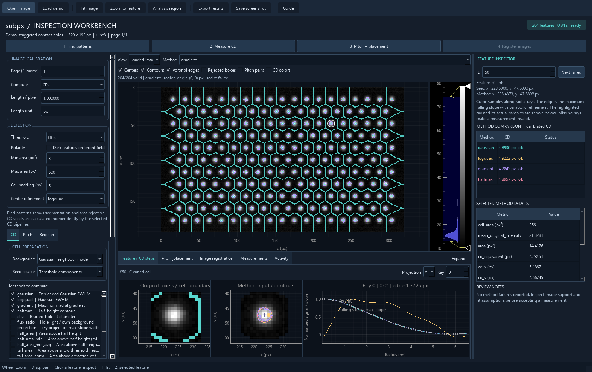
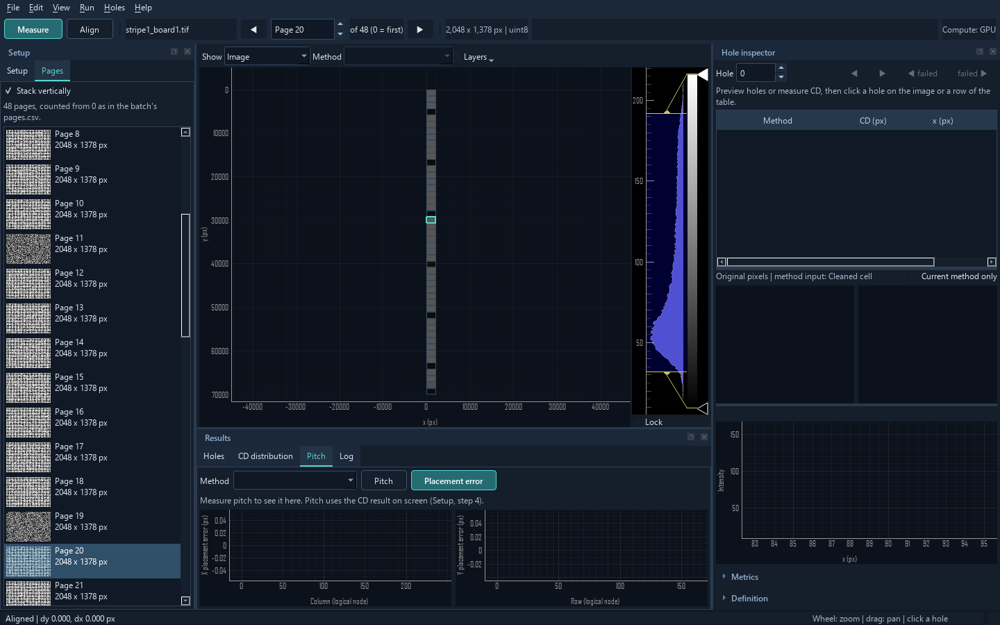
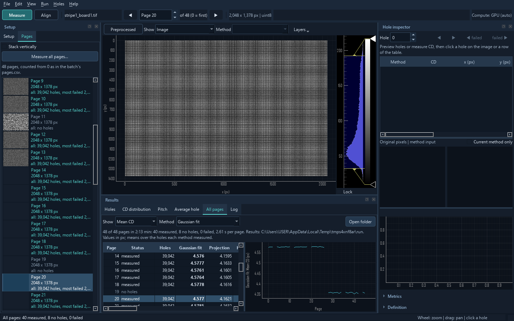

# Desktop inspection workbench

The PyQt6 application runs the repository's existing analysis methods on sample
images and uses pyqtgraph for every image, overlay and diagnostic plot. It is
separate from the OpenGL tiled notebook viewer in `subpx.viewer`.

From the repository root on Windows:

```powershell
.\.venv\Scripts\python.exe -m subpx.workbench --demo
.\.venv\Scripts\python.exe -m subpx.workbench path\to\image.tif [--page 5]
```

For a fresh installation:

```powershell
python -m pip install -e ".[analysis,viewer]"
subpx-workbench
```



## Layout

```
 File Edit View Run Holes Help
 [Measure|Align]  file.tif   ◀ Page 5 ▶ of 48   2048 x 1378 px | uint8        Compute: GPU (auto)
 ┌ Setup | Pages ┐ ┌ (error / "results are from earlier settings" banner) ┐ ┌ Hole inspector ─┐
 │ 1 Image     ● │ │ [Preprocessed] Show [Image] Method [Gaussian fit]    │ │ Hole 812 of 39k │
 │ 2 Preprocess ●│ │                                                      │ │ every method's  │
 │ 3 Holes     ● │ │     the active page, raw or preprocessed (or stack)  │ │ CD and status,  │
 │ 4 CD methods ●│ │                                                      │ │ pixels, profile │
 │ 5 Pitch     ● │ ├ Holes | CD distr. | Pitch | Avg hole | All pages | Log ┤ │                 │
 │ [Measure CD]  │ │                                                      │ │                 │
 └───────────────┘ └──────────────────────────────────────────────────────┘ └─────────────────┘
 status | hover position | job + elapsed + Cancel | all pages n of N + Stop | holes, mean CD, failures
```

- **Setup** (left) holds the steps in pipeline order: **Image** (pixel size,
  unit, polarity, compute device), **Preprocess** (Gaussian smoothing, Wiener
  filter or mean hole and its settings; see [Preprocessing](#preprocessing)),
  **Holes** (seeds, threshold, area limits with
  a histogram of the component areas and draggable limits), **CD methods**
  (preset, methods in groups with All / None, a *Parameters of the ticked
  methods* fold, calibration only when a calibrated method is ticked) and
  **Pitch** (source, lattice, averaging, design pitch, an *Advanced* fold with
  indexing hints). One step is open at a time; its **Run** button stays at the
  bottom. A disabled Run button says why directly under it (for example "Area
  min (300) is above area max (200)"), and the field at fault gets a red border.
  Each step has a mark: grey not run, green up to date, amber **changed** since
  the result on screen.
- **Pages** (the tab beside Setup) lists the file's pages, counted from 0 as in
  the batch's `pages.csv`, with thumbnails made as they scroll into view and a
  line on what was measured there ("CD 39,042 holes, most failed: Projection
  2,048", or "all: ..." from [Measure all pages](#measure-all-pages)). **Stack
  vertically** and **Measure all pages...** are here.
- The **image** shows the result chosen in the **Method** box: a CD method or
  **Previewed holes**. Running one step never hides another step's result: the
  box switches between them.
- The **hole inspector** (right) compares the selected hole in every method:
  CD, center and status per method with the method's colour, original pixels and
  the method's input with all contours (current one thick), the profile, the
  metrics and the definition. Click a method there to show it everywhere.
- The **bottom tabs** hold the **Holes** table, the **CD distribution**, the
  **Pitch** result, the **Average hole**, **All pages** and the **Log**. The Log
  never opens by itself.
- **Ctrl+1 / Ctrl+2 / Ctrl+3** show or hide Setup, the inspector and the bottom
  panel. Panel sizes, positions and the open tab are remembered. On a small
  screen (below 1300 x 800) Setup starts collapsed.
- The **status bar** shows the last message, the position under the mouse, the
  running job with its elapsed time and **Cancel**, and the result summary with
  the **failed holes of every method** ("Failed: Projection 2,048 (5 %) · Foot
  area 471 (1 %)"), not only of the method shown.

**The defaults are the batch's defaults** (`scripts/cd_batch.py`): the **Batch
default** preset (its ten methods: Gaussian fit, Projection, Half area, Half
area min level, Half area min level avg peak, Tail area, Tail area no level,
Edge area, Foot area, Foot area image ratio), area 3-200 px², padding 3,
deblend iterations 30 and stop tolerance 0.001, and **Compute: Auto** (the GPU
when CuPy works). A test pins them to `cd_batch`, so the workbench measures a
page as the batch does. Two more presets compare **Spot widths** (Gaussian, log
fit, gradient, half-height) and **Raw-cell widths**. The calibrated methods
(blurred hole fit, flux ratio) need a nominal CD or PSF and are only in the
full list. Every method has one display name everywhere; its library key and
label are in tooltips and exports.

**Settings are remembered** between sessions (every Setup control, layers,
locks, the table filter, the window and panel layout, the last folder and
recent files). **Edit > Reset settings** restores the defaults above; the image
and results stay.

## Keys

| Key | Action |
| --- | --- |
| Ctrl+O, or drop a file | open (File > Open recent lists the last 8) |
| Ctrl+Enter (either Enter key) | run the open Setup step |
| P | raw / preprocessed page, with their own results |
| F / Shift+F / Z | fit the page / fit the whole stack / zoom to the selected hole |
| J / K, Down / Up in the table | next / previous hole in the table's order (J = next, as in vim) |
| N / Shift+N | next / previous hole the current method failed on (wraps) |
| Page Down / Page Up | next / previous page, while the image or the page list has focus |
| Ctrl+Shift+A | Measure all pages (dialog) |
| Esc | cancel the running job, else stop Measure all pages |
| Ctrl+C | copy the selected table rows, or the selected hole's row (tab-separated) |
| Space | Align view: swap the reference and the aligned page |
| Ctrl+1 / Ctrl+2 / Ctrl+3 | show or hide Setup / Inspector / bottom panel |
| Ctrl+E | export |
| F1 | keys and workflow |

Every menu entry and button shows its key. Typing in a number or text field is
never taken by these keys. In the table, Page keys scroll the table.

## Errors, out-of-date results and jobs

- Errors appear as one plain line in a red banner over the image; the results
  stay visible. **Details** opens the full text in the **Log** tab. Unexpected
  errors in the window itself go to the same banner.
- When a setting differs from the one the result on screen was made with, an
  amber banner says what changed ("Results are from earlier settings: area max
  200 -> 150, threshold Otsu -> Triangle (+1 more)") with **Re-run** (the
  out-of-date step with the current settings) and **Revert** (the settings, and
  the analysis region, of the result on screen).
- Opening, measuring, aligning and exporting run on one background worker; the
  status bar shows the job and its elapsed time. **Cancel** (Esc) stops waiting
  and discards the result; the library call cannot be interrupted, so the worker
  finishes it in the background. Zooming, panning and inspecting stay available
  while a job runs.
- Opening another file and closing ask before discarding results. Closing while
  a job runs is refused with a hint to press Esc first.

## Preprocessing

Setup step **2 Preprocess** makes a preprocessed copy of the active page. The
choices are Gaussian smoothing (σ), the Wiener filter (noise level, Auto) or the
mean hole (K, box radius, Auto). The mean hole finds its holes on the raw page
with the Holes settings. The **Preprocessed** switch above the image (P, also
View > Preprocessed page) flips between the raw and the preprocessed page in the
same place, with the same contrast:

- Each page keeps a raw and a preprocessed version, each with its own previewed
  holes, CD and pitch. The switch flips the image, CD colours, holes table,
  inspector, CD distribution and pitch together.
- Runs measure the version on screen. On the preprocessed version, a missing or
  out-of-date preprocessed page is made first, in the same job.
- Turning the switch on makes the preprocessed page if there is none yet; so
  does showing another page while it is on. That takes 0.1 s (Gaussian), about
  2 s (Wiener) or about 5 s (mean hole, auto) for a 2048 x 1378 page on the CPU.
- The step shows what the method found (K or noise level, holes rebuilt, grey
  levels removed), and its help line gives the synthetic test's result.
- The summary line shows the other version's mean CD. **CD distribution** draws
  it as an outline with its mean and sd. The **hole inspector** adds a "CD raw"
  or "CD pre" column for the same hole, matched by position. Hovering shows both
  pixel values.
- **Show > Removed by preprocessing** maps raw minus preprocessed (red where
  preprocessing lowered the pixels, blue where it raised them).
- The **Average hole** tab stacks every hole of the result on screen (the
  current method's centres) on a 1/4 px grid, on the raw and on the preprocessed
  page. It shows x and y profiles through the centre and the width at half
  height of each.
- Changing a Preprocess setting marks only the preprocessed version as out of
  date. The banner offers Re-run and Revert.
- The stack's other pages and Align use raw pages.

What the methods do to CD, on synthetic truth and on a real page, is in
[preprocess.md](preprocess.md). In short, the automatic settings lower the CD
spread mostly by flattening real hole-to-hole differences.

## Image review

- Open TIFF, PNG, JPEG, BMP or a two-dimensional `.npy` array. A multipage file
  shows a page bar in the header (◀, the page number from 0, ▶) and the page
  list. A TIFF is opened once: its page table is read and the file stays open
  for page changes, the stack, thumbnails and moving pages of the same file.
- Changing the page keeps the zoom, the analysis region, the bottom tab, the
  image view, the selected position (after measuring, the hole at that position
  is selected) and the moving page, so one area can be followed through the
  pages. Tick **Lock** under the histogram to keep the contrast too; otherwise
  each page is stretched to its own 1-99.5 %. When a panel beside the image
  appears or hides (a banner, the CD scale), the image keeps its center and
  zoom and shows more or less of the page.
- **Stack vertically** displays all pages together, in file order. Click any
  page to make it active; its outline turns teal and the page list follows.
  Pages may have different dimensions or numeric types. They are displayed
  separately, with space between them, rather than concatenated into one
  measurement image. Analysis, regions, hole selection, alignment and export use
  the active page only. Overlays appear on that page. Hover reports the page
  number and coordinates local to that page (the pixel value when that page is
  in memory). **F** fits the active page, **Shift+F** the whole stack. Page
  labels appear while at most 12 pages are in view.
- Stacking reads nothing first: the file is open. Pages are decoded when they
  come into view, nearest the middle of the view first, a page at a time between
  other events. Zoomed out (3 or more image pixels per screen pixel) a page is
  drawn from a preview at most 256 pixels wide (block means); zoomed in, from
  the full page. Previews are kept for every page seen (about 44 kB for a 2048 x
  1378 8-bit page); full pages are kept up to 128 MB, the least recently used
  dropped first. Pages out of view are not drawn.
- Grayscale data retain their original precision. RGB is converted to luminance
  with `0.2126 R + 0.7152 G + 0.0722 B`; alpha is ignored. The conversion is
  displayed beside the image size. Nonfinite and complex images are rejected.
- Wheel to zoom, drag to pan. The histogram adjusts display levels without
  changing data or measurements.
- **Layers > Analysis region** shows a gold rectangle; drag it or its corners.
  The next run uses only that crop. Its boundaries can clip holes, affect seed
  detection and exclude cells. Pixel centers have integer coordinates, x is the
  column and y increases down the image.
- In **Image**, set the pixel size and its unit together before measuring. The
  UI displays calibrated lengths and areas; result arrays keep pixel units.



## Previewing holes

Open the **Holes** step, adjust seeds, threshold, area limits and refinement,
then **Preview holes**. The area histogram shows every component's area
against the two limits (drag a limit line to set it) and counts how many are
inside, smaller and larger. Switch **Show** to **Threshold mask** or
**Component labels** and turn on **Layers > Rejected boxes** to see components
outside the limits. The Method box then shows **Previewed holes**; the holes
table lists their positions and areas.

Detection input is rescaled to uint8 when required by OpenCV (uint16 Otsu is
retained); the Log records this. The rescaling does not replace the original
image used for CD.

## CD and intermediate steps

Open **CD methods**, choose a preset or tick methods, then **Measure CD**. All
methods in `subpx.cd.METHOD_LABELS` are available, with their prerequisites:
Gaussian and invariant methods require the model background; disk and flux
ratio require a nominal CD or PSF. Local-only methods bypass deblending. The
refinement of the Holes step applies to previewed holes; CD builds its own seeds
with its threshold or peak pipeline. **Show > Voronoi cells** draws the cell
boundaries on top of the image (the **Voronoi edges** layer does the same on
any view).

The image shows pages of 40,000 holes without slowing down:

- **Raster maps** are drawn at every zoom and made once per result and method:
  **CD colors** fills each Voronoi cell with its hole's CD (failed holes stay
  clear), **Failed cells** (on by default) tints the cells of the holes the
  shown method failed on in red, **Voronoi edges** draws the cell boundaries.
- **Centers, contours, all methods' contours, pitch pairs and rejected boxes**
  are drawn for the holes in view only, and only while at most 2,000 holes (or
  contours) are in view; farther out the line above the image says "zoom in to
  see centers and contours". Red crosses mark failed measurements at their seed
  positions; they remain selectable.
- Selecting a hole moves only its white ring; nothing else is redrawn.
- The **CD color scale** beside the image runs over 1-99 % of the shown
  method's valid CDs, so one outlier does not wash out the rest. Drag its ends
  to set a range; tick **Lock** under it to keep that range for every method
  and page.

The **holes table** keeps one column order: ID, x, y, status, CD x and CD y of
the shown method, then the CD of every method in the preset's order (the shown
one in bold). A sort (click a header) stays when the method or the filter
changes, and the selected hole keeps its row; J / K and N follow the table's
order. Filters: all holes, failed by the current method, failed by any method.
Type a hole ID and press Enter to select it. Click another method's CD column
to show that method. Right-click to copy a value, the selected rows or all rows
shown.

The **CD distribution** tab shows the current method's histogram with its mean
and spread. **Pick a range** puts a range on it: the holes in that range are
shaded on the image and the table lists only them (**Show all** ends it).

The hole inspector's crops and profile:

- **Gaussian:** input row, fitted Gaussian on that same row and the row residual.
- **Log-quadratic:** gold pixels show the actual fit-fraction support; the
  horizontal dashed line shows its intensity cutoff. The row is contextual, not
  a reconstruction of the two-dimensional fit.
- **Gradient / half-height:** a plot of the edge radius against the ray angle
  (failed rays as red crosses); click a ray there or on the input crop. The
  profile uses the same cubic sampling, smoothing, support mask and radial step
  as the CPU measurement. GPU measurements are diagnosed with CPU sampling of
  the returned NumPy input, so rounding can differ.
- **Projection / local projection:** choose x or y. Plots show the summed
  samples, the same zero-padded cubic spline and its derivative, and the picked
  steepest rising/falling edges.
- **Area methods:** compare the saved outline with the input and the reported
  threshold/local level. Wide-window methods store only the center of their
  measurement window for display; this is labelled.

Method definitions differ. A Gaussian FWHM, a gradient edge, a thresholded area
and a calibrated hole diameter should not be expected to have identical CDs.
Convergence and a successful status do not establish measurement accuracy.

## Pitch and placement error

Open **Pitch**, choose the source (**CD measurement** or **Previewed holes**),
then **Measure pitch**. Pitch uses that result of the active page as it is on
screen; it never measures again ("Measure CD first" otherwise). Averaging,
lattice, design pitch and a reference at the selected hole are in the step;
**Advanced** holds the stagger direction and pitch hints.

**GPU centers too** adds the older GPU center finders of `detect_centers`, side
by side with the result's own methods: log-quadratic, weighted, edge moment
(Preview centers calls it "Edge gradient"), edge erf, radial symmetry and
isophote curvature. Log-quadratic, edge moment and edge erf are ticked by
default. Each ticked finder runs on the GPU on the same page and with the same
hole settings. Each hole then takes the nearest finder center within half the
median hole spacing; a center goes only to its nearest hole. The Pitch tab's
method box lists the results as "GPU ... centers", on the same lattice and
reference hole as the CD methods, so clicked points pick the same holes. The
log and the summary say how many holes got a center. The edge finders were
made for large features: on the 39,042-hole test page (holes 8.5 px apart),
edge moment gave 19,769 holes a center and edge erf 19. Time on that page:
Measure pitch 0.6 s without finders, 2.8 s with the three defaults, 8.4 s with
all six. A finder that cannot run (no CuPy) is skipped with a line in the log.
Export writes their pitch CSVs like the CD methods' (`pitch_gpu_logquad_x.csv`).

The **Pitch** tab shows, for the chosen method, the x and y pitch in plain words
(mean, pairs, spread of single pairs, design, placement range, lattice,
reference, averaging) and two plots: **Pitch** per interval (the mean of its
pairs), or **Placement error** per row/column. Both are plain lines through the
measured values, with no markers, error bars or reference-node line, so the
y-axis spans the data; a value with no measured neighbour is drawn as a dot,
since a line cannot show it. Click a point: an interval picks the holes of its pairs,
a placement point the holes of that column or row; they are shaded on the
image, listed in the table, and the hole nearest their middle is selected. The
**Pitch pairs** layer draws gold x pairs, purple y pairs and the reference star.

Placement error is the discrete sum of `pitch - baseline`, zero at the
reference node. It is distinct from two-image alignment. Zero design pitches
select the measured means; set both to compare against a design pitch. Hints
are in pixels and affect indexing only. Missing intervals break cumulative
curves. The spread in the text is across contributing pairs, not repeated-image
precision. Irregular patterns can fail lattice indexing; the CD results stay.

## Measure all pages

**Measure all pages...** (Pages tab, Run menu, Ctrl+Shift+A) measures CD and
pitch on every page of the open multipage file with the current settings. The
dialog asks for:

- the pages (from / to, counted from 0);
- **Skip pages without holes**: each page is compared with the page on screen
  by the batch's hole check (`cd_batch.py`, Align's mode: **centered** passes
  below 0.8, **raw** below 0.3). Pages that fail are listed as "no holes" and not
  measured. Show a page with holes before starting;
- **GPU centers too**: the GPU center finders ticked in Setup > Pitch, for the
  pitch only;
- the results folder (default: `<file>_all_pages_<date>_<time>` beside the file;
  a folder that already holds a `pages.csv` is refused).

How it runs: one reader thread reads the pages front to back, one pass through
the file as the batch reads. Worker processes measure them, one per GPU (every
GPU `nvidia-smi` lists, or those in `CUDA_VISIBLE_DEVICES`), each with two pages
at a time, so one page's CPU steps overlap the other's GPU work. Each page is
measured with all its holes at once on the GPU, in the batch's fast mode
(`measure_cds(summary_only=True)`: no contours, cell images or label maps). The
CDs are the same as Measure CD gives, to the last bit, and a test pins it. The
page's pitch then follows, with the Pitch settings and each page's default
reference hole; the GPU finders run when ticked. On the CPU (Compute: CPU, or no
GPU), one worker measures one page at a time.

The window stays usable: pages can be shown, zoomed and inspected while the run
goes on. Other runs, opening another file and closing wait; Setup says why. The
status bar shows pages done, pages without holes, failures, seconds per page and
the time left, with **Stop** (Esc). Stopping drops the pages being measured; the
rows so far stay in `pages.csv`. A page that fails (an error, or a worker that
stops or takes over 10 minutes) is listed as failed with the reason, and its
worker is restarted.

The **All pages** tab lists the run's pages: status, holes, and for every method
the value chosen in **Show**: mean CD, mean CD x or y, holes measured, holes
failed, pitch x or y, or the placement error range in x or y. The plot shows
the chosen method's value by page as a plain line (placement: its lowest and
highest value). Click a column header to plot that method. Click a row or a
point to show that page. To inspect its holes, run Measure CD on it: the full
result (contours, pixels) of one 39,000-hole page takes about 1.1 GB, so it is
not kept for every page. The page list adds a line per page ("all: 39,042
holes, most failed 2,048", "all: no holes", "all: failed"). **Open folder**
opens the results:

- `pages.csv`: one row per page, in page order. First the batch's columns with
  the same values (`file, page, status, pcc_error, holes, image_intensity,
  cell_intensity, deblend_*`, and per method `<m>_valid, <m>_cd, <m>_cd_x,
  <m>_cd_y` in the unit). Then, per pitch method (the CD methods and
  `gpu_<finder>`), `<m>_pitch_x, <m>_pitch_y, <m>_placement_x_min/_max,
  <m>_placement_y_min/_max`, and finally `pitch_error, error, seconds`. Status
  is `ok`, `no_holes` or `failed`.
- `holes/page_NNNN.csv`: every hole of that page. `hole, x, y` in page pixels,
  then per method `<m>_cd, <m>_cd_x, <m>_cd_y` (unit; empty where the method
  failed) and `<m>_status`.
- `run.json`: the file, pages, settings, hole check, GPUs, times, counts and the
  git commit.



Speed on this PC (one RTX 4060 Ti, Windows), `stripe1_board1.tif`: 48 pages
of 2048 x 1378 px, 39,042 holes on each page with holes, the ten batch methods.
40 pages were measured and 8 had no holes (3, 11, 19, 27, 35, 43, 46, 47):

| Run | Whole file | Per page, once running |
| --- | --- | --- |
| Measure all pages, no GPU centers | 132 s | 2.6 s |
| Measure all pages, the 3 default GPU centers | 209 s | 4.1 s |
| Measure CD page by page in the window | about 5.5 min for the 40 pages, plus a click each | 8.1-8.8 s |

One page measured alone takes: hole check 0.17 s, CD 3.25 s, pitch 0.5 s, the
three default GPU center finders 2.2 s more, and the hole CSV 0.5 s. Two pages
at a time on the GPU overlap part of that. Measure CD on pages 5 and 20 gave
every method's mean CD equal to the run's, with a difference of 0. The longest
pause of the window during the run was 0.05 s. With more GPUs each runs its own
worker. That has not been measured here (one GPU); if it scales like the batch,
it is about the time above divided by the number of GPUs.

## Align

Switch the header to **Align**. Setup then lists the pages of the open file
(**This file**) or of another file (**Other file...**); click a page: it is read
and aligned to the active page (the reference) at once. The moving page stays
when the reference page changes, so several pages can be aligned to one moving
page, or one reference page to several (click another page in the list), with
**Ctrl+Enter** to align again. The pages must have matching dimensions.
Alignment uses the full pages, independently of the analysis region or the
stack.

The comparison fills the main image area: **Flicker** (Space swaps the
reference and the aligned page), **Difference before** and **after** on one
symmetric colour scale, **Checkerboard** (block size adjustable) and **Blend**.
The panel on the right gives the shift to apply to the moving page in `[dy,
dx]` pixels and in words, the RMSE before and after on the same overlap, the
batch's **hole check** (`cd_batch.py`, same function, pinned by a test:
**centered** passes below 0.8, **raw** below 0.3; when it fails the batch would
skip the page as "no holes" and the shift may mean nothing), and the phase
correlation around its peak with the runner-up marked. A runner-up above 0.8
of the best warns that on a repeating pattern the shift may be off by whole
pitches.

## Export

**File > Export** (Ctrl+E) asks for a folder (default: a new
`inspection_<date>_<time>` folder beside the opened file) and what to write:

- **Holes table as shown** (filter and sort) as `holes_table.csv`.
- **All result arrays**: native CD arrays, tables and manifest from
  `save_cd_results`, or detection labels, area decisions and global center
  coordinates; per-method, per-axis pitch CSVs (in `pitch/` when the pitch was
  measured on another result than the one shown); `workbench.json` with the
  parameters, time, notes, warnings and crop origin.
- **Alignment**: `registration.npz` with the shift, aligned page, valid overlap,
  difference images and correlation.

`source.json` is always written: file, zero-based active page, page count,
display mode (`page` or `stack`), the method shown, the page version (`raw` or
`preprocessed`), the moving page and the alignment's shift, RMSE and hole check.
When the page is preprocessed, it also holds the preprocessing settings and
findings. With the result arrays, `preprocessed_image.npy` (float32, the whole
page) and `preprocess_meta.npz` (Noise2Self curves, per-hole brightness) are
written. CD exports use crop-local `[x, y]`
coordinates; add `origin_xy` from `workbench.json` for page coordinates. The
detection-only `centers_global_xy.npy` already includes the origin. **Save
screenshot** saves the window as a PNG.

## Memory

Results are kept per page (previewed holes, CD and pitch of the raw and the
preprocessed version, and the preprocessed page, 11 MB for 2048 x 1378) for the
open page and the most recently measured other pages: at most 3 pages and 3 GB (one
39,042-hole page measured with the ten batch methods holds about 1.25 GB, so
then the open page and the one before). Pages without results take no place.
Older pages' results are dropped, with a line in the Log; the page list keeps
saying what was measured there. Opening another file clears all results.

## NumPy / notebook use

```python
import subpx

# In IPython/Jupyter, first execute: %gui qt
window = subpx.launch_workbench(image, name="Inspection image", block=False)
```

In a normal Python script, omit `block=False` so the function starts the Qt
event loop if necessary. Importing `subpx` does not import this optional UI.

## Code

`subpx/workbench/` is a package: `session.py` holds the state (open file, page,
results per page, method, selection, moving page, alignment, settings) and runs
the jobs (`jobs.py`); `window.py` builds menus, header, docks, banners and the
status bar; `canvas.py` the image view, its layers and the stack;
`panels/` the Setup steps, page list, hole inspector, holes table, CD
distribution, pitch, average hole, Align view and log. Panels listen to the session's signals
and call its methods, never each other. `names.py` and `settings.py` (method
names, settings labels, run checks) do not import Qt. The Qt-free data layer
stays in `subpx/_workbench_data.py`; Measure all pages (reader, worker processes,
output files) is the Qt-free `subpx/_workbench_pages.py`, so its workers never
load Qt.

## Validation

```powershell
$env:QT_QPA_PLATFORM = "offscreen"
.\.venv\Scripts\python.exe -m pytest tests/test_workbench_data.py tests/test_workbench_pages.py tests/test_workbench.py -q
```

The tests use their own settings file, never your saved settings.
`scripts/workbench_timing.py` times clicks, method switches, layer toggles and
repaints on a page of your size (default: `artifacts/cd_test/data/stripe1_board1.tif`),
the memory over the following pages, and the stack of that 48-page file.
On this PC (RTX 4060 Ti, 39,042 holes, ten methods): Measure CD 7.4 s, click
0.03-0.05 s, J 0.03 s, N 0.001 s, method switch 0.04-0.06 s, layer toggle
0.004-0.02 s, repaint 0.003 s at full view and 0.02 s zoomed in with 1,225
holes drawn; memory 1.9 -> 3.0 -> 4.2 -> 4.4 -> 4.3 GB over five measured
pages; the 48-page stack turns on in 0.12 s and fills its view in 0.26 s.

Tests cover the batch defaults, remembered settings and layout, Reset, disabled
styles and Run reasons, the Setup steps and their Run button, docks and
Ctrl+1/2/3, the stale banner with Revert and Re-run, J / K / N / Shift+N in the
table's order, Ctrl+C, picking holes from a CD range and from a pitch point,
asking before discarding results, Cancel, refusing to close while busy, Page
keys scoped to the image and the page list, the page list and the stack
following each other, the CD map, its scale and lock, the selection redrawing
nothing else, centers and contours for the holes in view only, the table's
fixed columns and kept sort, results kept for the last pages only, stack
previews, full pages in view and their memory cap, F / Shift+F, per-method
failure counts, the state kept across pages, the Align view and the batch's
hole check, the error banner, unreadable pages and files, page-local
overlays/crops/exports, compatible presets, calibration guidance, method
comparison, crops and coordinate origins, export, raw and wide method inputs,
known registration shifts and actual Qt workers. For preprocessing they cover
raw and preprocessed results kept apart, the switch and P keeping the contrast,
the other version's CD in the inspector, summary and distribution, the stale
banner, Revert and Re-run for the preprocessed version only, Removed by
preprocessing, export of the preprocessed page, the mean hole and Wiener runs,
preprocessing a page when it is shown, and the average hole of both versions. Qt tests skip if PyQt6 or
pyqtgraph is not installed.

## Known gaps

- Opening a `cd_batch` run (its settings and page list) is planned (P3). An
  earlier Measure all pages run is not reopened either: its folder holds the
  results; the All pages tab shows the run of the open file only.
- Measure all pages does not resume a stopped run; start it again into a new
  folder (or for the remaining pages).
- Progress shows the job and its elapsed time, not the stage inside a CD run:
  the library call reports no progress.
- The analysis region is set by dragging only (no typed x0 y0 x1 y1).
- Preprocessing runs on the CPU (NumPy). While the preprocessed version is on,
  each newly shown page waits for its preprocessing (Esc cancels).
- Previewed holes list their kept components; rejected components are counted
  in the Holes step and drawn with **Rejected boxes**, not listed in the table.
